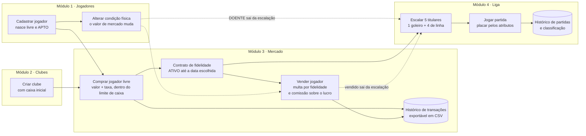
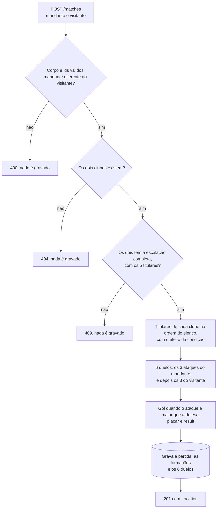
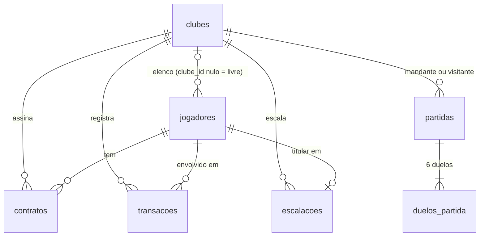
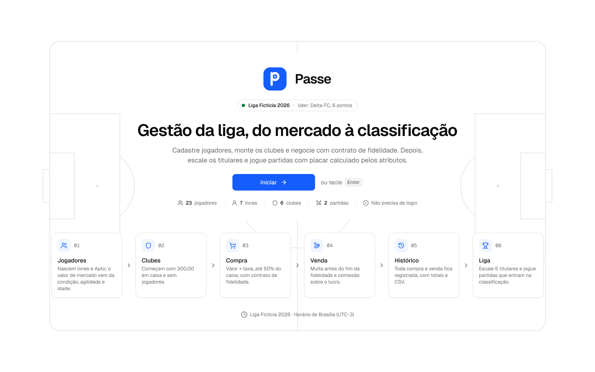

# ⚽ Estudo de Caso – SENAI/PE – CÓD. 237 DESENVOLVEDOR I (FULLSTACK)

O Instituto SENAI de Inovação, do Sistema FIEPE, está em busca de **desenvolvedores com perfil versátil**, capazes de atuar tanto no **backend quanto no frontend**. Este estudo de caso faz parte do processo seletivo para a vaga de **Desenvolvedor Fullstack I**.

O objetivo é avaliar sua **habilidade técnica**, **clareza de raciocínio**, **organização de código** e **capacidade de entregar uma aplicação funcional a partir de regras de negócio bem definidas**.

Mais do que domínio técnico, valorizamos a **capacidade de pensar de forma estruturada**, escrever **código limpo**, seguir **boas práticas** e tomar **decisões conscientes** durante o desenvolvimento.

> 📌 Este enunciado substitui a seção 4 e o barema do documento principal (regulamento); o barema está em [barema.md](barema.md). Prazo, entrega, tecnologias, uso de IA e eliminação seguem o regulamento. Em caso de divergência entre documentos, vale esta ordem: regulamento (fora da seção 4 e do barema), erratas, barema (para a pontuação) e este enunciado (para os requisitos); o glossário, o mockup e o exemplo de ficha de avaliação são informativos.

---

## 🧭 Como ler este enunciado

O texto é longo porque traz todas as regras e muitos exemplos. Sugestão de leitura:

1. **Entenda o problema:** 🎯 Objetivo, 🔄 Como o sistema funciona e o [glossário](glossario.md) dos termos usados.
2. **Veja como será corrigido:** 📊 Como será a nota e o [barema](barema.md), que diz, item a item, o que será verificado e quanto vale. Use-o para priorizar.
3. **Leia as regras gerais:** 📏 Premissas e regras gerais valem para **todos** os endpoints (validação, limites, arredondamento, datas e convenções).
4. **Implemente por funcionalidade:** 🚨 Funcionalidades Obrigatórias traz, para cada funcionalidade, as regras de negócio e, na maioria delas, exemplos. **As tabelas de exemplos foram conferidas e podem ser usadas como casos de teste.**
5. **Consulte o contrato da API:** 📚 Documentação dos principais endpoints traz requisições, respostas e os principais erros de cada endpoint.

Os exemplos de cada seção usam nomes e valores fictícios e **não fazem parte do roteiro de testes**. Itens do regulamento citados aqui e no barema (ex.: 3.4 e 5.6.4) estão no documento principal, que você também recebeu: mantenha-o à mão.

---

## ✅ O que esperamos ver no seu projeto

- Organização do projeto com **estrutura clara e lógica** (pastas `frontend/` e `backend/`, conforme o regulamento)
- Uma **aplicação funcional** que percorra o fluxo completo: jogadores → clubes → compra com contrato → venda → histórico → escalação → partidas e classificação
- **Regras de negócio aplicadas exatamente como descritas**, inclusive nos casos-limite, nos percentuais e nos arredondamentos
- **Padrões de código limpo** (clean code) seguidos no backend e no frontend: nomes claros e no padrão da linguagem, funções e componentes com uma só responsabilidade, camadas separadas, regras de negócio sem duplicação, tratamento de erros centralizado e nenhum código morto ou comentado. A qualidade do código é avaliada pelos critérios B2 e F2 do [barema](barema.md)
- Uso de **Git** com histórico **coerente de commits**
- Projeto **individual**: nenhuma outra pessoa escreve código do projeto; consultar documentação e fóruns é permitido, e o uso de IA segue a regra de 🧭 Stack obrigatória

---

## 🌟 Diferenciais técnicos que contam pontos

Não são obrigatórios. Cada um vale 0,5 ponto no critério B5 do [barema](barema.md), até 2 pontos, desde que funcione e o README explique como executá-lo.

- **Testes automatizados no backend**, executados pelo comando do README, que termina sozinho (sem modo de observação) e sem falhas, com ao menos um teste do cálculo do valor de mercado (RN02 a RN05)
- **Docker e Docker Compose**: um único comando sobe interface, API e banco
- **Documentação interativa da API** (Swagger/OpenAPI) com os endpoints deste enunciado
- **Registro de logs** de cada requisição (data e hora, método, caminho e status), por biblioteca de log (do framework, da biblioteca padrão ou declarada nas dependências; `print` e `console.log` não contam)
- **Lint e formatação** configurados no backend (ex.: ESLint e Prettier, Checkstyle, Ruff ou Black), executados pelos comandos do README sem erros (o de formatação só verifica, sem alterar arquivos)

Os diferenciais de interface estão na seção 🖥️ Frontend.

---

## 📊 Como será a nota

A nota vai de 0 a 10 e é dividida igualmente entre as duas partes do projeto: **até 5,0 pelo backend** e **até 5,0 pelo frontend**. São 100 pontos no total, e a nota final é a soma dos pontos ÷ 10. A nota mínima para aprovação é **7,0**, com pelo menos **2,5 no backend** e **2,5 no frontend**.

| Parte | O que é avaliado (pontos) | Total | Na nota |
| --- | --- | --- | --- |
| Backend | Roteiro da API (30), qualidade do código (10), banco de dados (6), README e Git (2), diferenciais técnicos (2) | 50 | 5,0 |
| Frontend | Roteiro da interface (30), qualidade do código (10), usabilidade e feedback (6), README e Git (2), diferenciais de interface (2) | 50 | 5,0 |

Como a nota é cobrada:

1. **Versão corrigida:** o commit cujo hash você informar no e-mail de entrega; nada depois dele é considerado.
2. **Ambiente:** numa máquina limpa com Ubuntu 24.04 e Docker (especificação completa no barema), a banca segue o seu README exatamente como está escrito, em até 30 minutos, para criar o banco e subir o backend e o frontend, sem alterar nada. O banco é recriado do zero antes de cada roteiro. Se a aplicação não subir, vale zero o que depende dela no ar: os roteiros, a usabilidade e os diferenciais que exigem a aplicação no ar (lista completa no barema, seção 3.2).
3. **Roteiro da API:** um script automatizado, o mesmo para todos, chama a API pela origem informada no seu README, acrescida de `/api/v1`, com dados próprios da banca (os exemplos deste enunciado não são usados). Ele segue os itens do barema, na ordem, e confere o código HTTP, o corpo e os cabeçalhos de cada resposta; numa recusa, confere também que o corpo traz o `message` (o texto é livre) e, consultando a própria API, que nada foi gravado. As datas são calculadas a partir do momento da execução, e cada item vale a pontuação integral ou zero. O formato dos pedidos, o tempo de resposta e as comparações estão no barema, seção 3.3.
4. **Roteiro da interface:** executado na tela, com o mesmo roteiro e os mesmos dados para todos. Cada item vale a pontuação integral ou zero. Antes de serem congelados, os dois roteiros são ensaiados numa implementação de referência, feita pela banca a partir deste enunciado (barema, seção 3.7).
5. **Leitura do código e uso da interface:** qualidade do código (padrões de código limpo), banco de dados, README, histórico do Git e usabilidade são avaliados por um avaliador, com rubrica de três níveis (atende, atende em parte ou não atende). Os diferenciais do backend e os de testes e de lint no frontend valem a pontuação cheia se funcionarem e o README explicar como executá-los; a responsividade vale se funcionar.

O barema completo, com o processo de correção e os pontos de cada item, está em [barema.md](barema.md), e um exemplo de ficha de avaliação preenchida, em [ficha-avaliacao-exemplo.md](ficha-avaliacao-exemplo.md). Recursos seguem o prazo e a forma do regulamento (barema, seção 3.6).

---

## 🎯 Objetivo

Este estudo de caso simula o **mercado de jogadores de uma liga de futebol fictícia**. Os clubes compram jogadores com **contrato de fidelidade** e podem vendê-los depois; o preço de cada jogador muda conforme a condição física, a agilidade e a idade; quem vende antes do fim da fidelidade paga multa; cada compra e venda fica registrada no histórico do clube; e os clubes escalam os titulares e jogam partidas, com o placar calculado pelos atributos dos jogadores. Não é preciso entender de futebol: todas as regras e cálculos estão escritos aqui, com exemplos.

Você será responsável por desenvolver uma aplicação web fullstack com quatro módulos:

1. **Jogadores:** cadastro, edição, condição física, cálculo do **valor base** (pelo overall e pelo potencial, uma vez, no cadastro) e do **valor de mercado** (percentuais por condição, agilidade e idade), com **indicadores técnicos** (overall calculado, potencial e seis atributos), listagem **paginada**, busca e filtros e **exclusão lógica**
2. **Clubes:** cadastro, caixa, elenco com contratos, valor do elenco e patrimônio, com listagem ordenável pelo patrimônio
3. **Mercado:** **compra** com taxa, limite de 50% do caixa e contrato de fidelidade; **venda** com multa por fidelidade e comissão progressiva sobre o lucro; e **histórico de transações** com totais
4. **Liga:** **escalação** dos 5 titulares de cada clube, sempre com 1 goleiro e 4 jogadores de linha numa **formação**, **partidas** com placar calculado pelos atributos dos jogadores, **histórico de partidas** e **classificação**

A proposta avalia sua capacidade técnica e de organização e, principalmente, sua **atenção às regras de negócio**: percentuais, limites, datas, arredondamentos, ordem das validações e comportamento em situações de erro.

---

## 🧭 Stack obrigatória

As tecnologias seguem o item 3.4 do regulamento. Tecnologia fora da lista elimina o candidato.

| Camada | Tecnologia aceita | Versão | Para que será usada |
| --- | --- | --- | --- |
| Frontend | React (JavaScript ou TypeScript), com projeto criado em [Vite](https://vite.dev) ou [Next.js](https://nextjs.org) | React 18 ou superior; Next.js 14 ou superior | Telas, formulários, navegação e consumo da API |
| Backend (opção 1) | Node.js com TypeScript, usando [NestJS](https://nestjs.com), [Express](https://expressjs.com) ou [Fastify](https://fastify.dev) | Node.js 20 LTS ou 22 LTS | API REST, regras de negócio e acesso ao banco |
| Backend (opção 2) | Java com [Spring Boot](https://spring.io/projects/spring-boot) 3 (Maven ou Gradle) | Java 17 ou 21 | API REST, regras de negócio e acesso ao banco |
| Backend (opção 3) | Python com [FastAPI](https://fastapi.tiangolo.com), Django (com [Django REST Framework](https://www.django-rest-framework.org)) ou [Flask](https://flask.palletsprojects.com) | Python 3.11 ou superior | API REST, regras de negócio e acesso ao banco |
| Banco de dados | PostgreSQL, MySQL, MariaDB ou Oracle | PostgreSQL 14 ou superior; MySQL 8.0 ou superior; MariaDB 10.6 ou superior; Oracle Database 19c ou superior (inclui as edições gratuitas XE e Free) | Armazenamento dos dados, com chaves e restrições |
| Versionamento | Git, com repositório público no GitHub ou no GitLab | qualquer | Histórico do desenvolvimento e entrega do projeto |

O backend usa uma das três opções e expõe a API REST deste enunciado.

### Frontend

- No Vite, vale qualquer template React oficial (`react`, `react-ts`, `react-compiler` ou `react-compiler-ts`). O frontend é executado com Node.js 20 LTS ou 22 LTS, as mesmas versões da opção 1 do backend.
- No Next.js, rotas de API, Route Handlers e Server Actions **não podem** acessar o banco nem calcular o que a API devolve: servem só para repassar as chamadas ao backend (proxy ou rewrite), com validação de formulário antes do repasse, se quiser.
- Esperado: **componentes reutilizáveis**, estado com `useState`/`useEffect` (e, se necessário, Context API ou biblioteca de estado) e integração com a API com **tratamento de carregamento e de erro**.
- Não aceito: Remix, React Router no modo framework, Create React App, Angular, Vue ou outro framework.

### Banco de dados

- Não aceito como banco da aplicação: SQLite (em arquivo ou em memória), H2, HSQLDB, MongoDB ou armazenamento em arquivos JSON. Nos testes automatizados, qualquer banco é permitido.

### Bibliotecas complementares

Livres, desde que **listadas no README com o motivo do uso**. Exemplos:

- Interface e estilo: [Tailwind CSS](https://tailwindcss.com), [shadcn/ui](https://ui.shadcn.com), MUI, Bootstrap
- Rotas: [React Router](https://reactrouter.com) (no modo biblioteca) ou [TanStack Router](https://tanstack.com/router), conforme a necessidade
- Formulários e validação: React Hook Form, Zod, Yup, Pydantic, Bean Validation
- Requisições: `fetch` ou Axios; estado: Zustand, Redux
- ORM: Prisma, TypeORM, Sequelize, Hibernate/JPA, SQLAlchemy, Django ORM

### Uso de inteligência artificial

É permitido. A seção **“Uso de inteligência artificial”** do README é obrigatória: quem usou declara quais ferramentas, **onde** (arquivos ou funcionalidades), **como e por que** foram usadas e o que aceitou, alterou ou descartou; quem não usou escreve “Não utilizei”. O uso declarado não reduz a nota, mas pode ser questionado na entrevista.

---

## 🔄 Como o sistema funciona

O sistema segue uma ordem: primeiro existem os jogadores e os clubes; depois os clubes compram (assinando um contrato de fidelidade) e vendem, e tudo fica no histórico; com o elenco formado, escalam os titulares e jogam partidas, que entram no histórico de partidas e na classificação.



| Etapa | O que acontece | Módulo |
| --- | --- | --- |
| 1. Jogadores | Cadastram-se os jogadores, que nascem livres e APTO. O valor base é calculado no cadastro pelo overall e pelo potencial (RN06), e o valor de mercado, pela condição física, pela agilidade e pela idade (RN02 a RN05); a edição tem limites (RN08); jogador livre pode ser excluído (RN09). | 1 |
| 2. Clubes | Criam-se os clubes, com caixa inicial e sem jogadores (RN10 e RN11). | 2 |
| 3. Compra | O clube compra um jogador livre pelo valor de mercado mais taxa, dentro dos limites de caixa e de elenco (RN12 a RN14), e escolhe o fim da fidelidade do contrato. | 3 |
| 4. Venda | O clube vende um jogador do elenco pelo valor de mercado; antes do fim da fidelidade paga multa (RN15) e, com lucro, paga comissão (RN16). O jogador volta a ficar livre. | 3 |
| Histórico | Toda compra e venda fica no histórico do clube, com os valores do momento, filtros e exportação em CSV (RN17 e RN18). | 3 |
| 5. Escalação | O clube escolhe a formação e escala 5 titulares do elenco: 1 goleiro e 4 jogadores de linha (RN19). Titular vendido ou que passa a DOENTE sai da escalação, e o clube só volta a jogar quando escalar de novo. | 4 |
| 6. Partidas | Dois clubes com escalação completa jogam: o placar sai de 6 duelos entre os titulares, sem sorteio (RN20). As partidas formam o histórico de partidas e a classificação (RN21). | 4 |

### Glossário

Os termos usados neste enunciado estão no arquivo [glossario.md](glossario.md).

---

## 📏 Premissas e regras gerais

Valem para todos os módulos. **Toda regra é validada no backend**, mesmo que a interface também valide.

### Premissas

- **Sem login:** não há usuários, login nem controle de acesso. Quem usa o sistema administra a liga inteira: cadastra jogadores e clubes e faz as operações de todos os clubes. Por isso, cada operação diz o clube envolvido: o jogador é cadastrado livre, sem clube; a compra indica o clube comprador (`club_id`); a venda é sempre feita pelo clube atual do jogador; e a escalação e o histórico usam o clube da URL (`/clubs/{id}`).
- **Moeda:** “moedas”, unidade fictícia, sempre com 2 casas decimais.
- **Arredondamento:** feito **uma única vez, no resultado final** de cada cálculo em moedas, para 2 casas. Quando o algarismo seguinte ao último mantido for 5, arredonda-se **para longe do zero** (14,775 → 14,78; 0,385 → 0,39). Um valor que é resultado de outra regra (como o valor base e o valor de mercado) entra no cálculo seguinte já arredondado.
- **Ordem alfabética:** sempre que uma regra ordenar por nome, os nomes são convertidos para minúsculas, têm os acentos removidos e são comparados caractere a caractere pela ordem Unicode: o espaço vem antes do hífen, e o hífen antes das letras (“Épsilon” fica entre “Delta” e “Gama”; “Ana Lima” vem antes de “Ana-Maria”). Nomes iguais nessa comparação (como “Águias FC” e “Aguias FC”) empatam, e o empate é desfeito pelo id crescente.
- **Números nas respostas:** são números JSON; `40`, `40.0` e `40.00` são o mesmo valor, e a correção compara o valor numérico.
- **Detalhes não definidos:** você decide e registra a decisão no README (item 6 de 📘 Requisitos do README.md).

### Validação dos dados

- **V1:** O corpo das requisições é um **objeto** JSON. Corpo que não é JSON válido, ou que é um array ou um valor simples (`[]`, `"x"`, `10`), é recusado com 400. Nos pedidos sem corpo (consultas, exclusão e venda), um corpo enviado é ignorado.
- **V2:** Cada campo chega no tipo indicado em “Limites de cada campo”. Número é número JSON: `15` é válido, e `"15"` (texto) é recusado. Campo inteiro não aceita parte fracionária: `50.5` é recusado, e `50.0` vale 50 e é aceito.
- **V3:** Nenhum valor em moedas é enviado no corpo das requisições: valor base, valor de mercado, caixa, taxas, multas e comissões são calculados pela API e vêm nas respostas com 2 casas. Um campo de moeda enviado no corpo (como `base_value` ou `cash`) é ignorado (V7). Os únicos valores em moedas enviados à API são os filtros `min_value` e `max_value`, com o formato de “1. 🧾 Filtros e query params aceitos”.
- **V4:** Nos campos de nome e no `search`, espaços no início e no fim são removidos e espaços repetidos viram um só, antes de validar o tamanho e gravar. Caracteres de controle (como tabulação e quebra de linha) são recusados com 400. Texto que fica vazio conta como ausente; no `search`, é recusado com 400. Ex.: `"  Meia   Zeta "` é gravado como `"Meia Zeta"`.
  - Definições usadas em todo o enunciado: **caractere** é um ponto de código Unicode; **espaço** é o caractere U+0020; **letra** é qualquer caractere da categoria Unicode L; **dígito** vai de 0 a 9; **palavra** é uma sequência sem espaços com pelo menos uma letra; **ignorar acentos** é decompor o texto na forma NFD do Unicode e retirar as marcas de acento (categoria Unicode Mn), o que inclui a cedilha (“ç” equivale a “c”).
- **V5:** Valores de lista são enviados exatamente como escritos aqui, com as mesmas maiúsculas e minúsculas (`ATA`, `MAL_CONDICIONADO`, `value_desc`, `true`). `"ata"` e `"TRUE"` são recusados, nunca convertidos.
- **V6:** Campo obrigatório ausente ou `null` é recusado.
- **V7:** Campos que o sistema calcula ou controla (ex.: `id`, `cash`, `market_value`; no cadastro e na edição de jogador, também `club_id` e `condition`; no `PUT`, também os indicadores; em qualquer pedido, `overall` e `base_value`) e campos que não pertencem ao endpoint, inclusive os que não existem neste enunciado e os de outros endpoints (como `name` no `PATCH` de condição), são **ignorados, sem erro**.
- **V8:** Recurso da URL inexistente → 404; `club_id` inexistente na compra → 404.
  - Id na URL que não é um inteiro positivo escrito só com dígitos, sem zeros à esquerda (como `abc`, `0`, `-1`, `1.5` e `01`), ou que passa de 2.147.483.647 também conta como inexistente → 404.
  - Nos ids do corpo (`club_id`, `player_ids`, `home_club_id` e `away_club_id`), a correção não envia valores acima de 2.147.483.647, como nos query params.
  - Jogador excluído (RN09) conta como inexistente em todos os endpoints que recebem o id dele (na URL, no corpo ou num filtro); as transações e as partidas antigas continuam mostrando o jogador como foi gravado.
- **V9:** Códigos de erro: dado, formato ou parâmetro inválido → `400`; recurso inexistente → `404`; regra de negócio → `409`. A correção nunca combina dois erros no mesmo pedido.

### Limites de cada campo

Os limites são **inclusivos**: o mínimo e o máximo são aceitos. Valor enviado fora do limite é **recusado com 400**, nunca ajustado; os limites marcados com 409 dependem do estado atual e são regras de negócio (V9).

| Campo | Onde | Tipo | Aceito |
| --- | --- | --- | --- |
| `name` | Jogador | texto | 3 a 100 caracteres, depois da V4, com pelo menos duas palavras e nenhum dígito |
| `position` | Jogador | lista | `GOL`, `ZAG`, `LAT`, `MEI` ou `ATA`; no `PUT`, jogador com clube não muda de posição (409) |
| `agility` | Jogador | inteiro | 1 a 100; com 35 anos ou mais, no máximo 85 |
| `age` | Jogador | inteiro | 16 a 45; no `PUT`, não pode ser menor que a idade atual (409) |
| `pace`, `shooting`, `passing`, `dribbling`, `defending`, `physical` | Jogador (só no cadastro) | inteiro | 1 a 99 cada; a soma dos seis não pode passar de 480 |
| `potential` | Jogador (só no cadastro) | inteiro | 1 a 99 **e** maior ou igual ao maior dos seis atributos (RN06); no cadastro de jogador com 33 anos ou mais, igual ao maior dos seis atributos (um `PUT` que leve a idade a 33 ou mais é aceito, sem mudar o `potential`) |
| `condition` | Alteração de condição | lista | `APTO`, `MAL_CONDICIONADO` ou `DOENTE`; de `DOENTE` não vai direto para `APTO` (409); enviar a condição atual é aceito (200), sem mudança |
| `name` | Clube | texto | 3 a 60 caracteres, depois da V4, com 2 a 5 palavras; só letras (com ou sem acento), espaços, hífen e ponto |
| `acronym` | Clube | texto | exatamente 3 letras de A a Z, maiúsculas e sem acento, que aparecem no nome do clube nessa ordem, sem diferenciar maiúsculas, minúsculas e acentos, sendo a primeira delas a primeira letra do nome; as três letras não podem ser todas iguais |
| `club_id` | Compra | inteiro | inteiro positivo de clube existente; 0 ou negativo → 400; inexistente → 404 |
| `loyalty_until` | Compra | data e hora no formato da RN01 | depois do momento da compra e até 1.095 dias depois dele |
| `formation` | Escalação | lista | `3-1`, `2-2`, `2-1-1` ou `1-2-1` (RN19) |
| `player_ids` | Escalação | lista de inteiros | exatamente 5 ids, distintos e inteiros positivos (400); jogador inexistente → 404; fora do elenco, `DOENTE` ou posições que não fecham a formação (1 GOL e os jogadores de linha de cada setor) → 409 (RN19) |
| `home_club_id` e `away_club_id` | Partida | inteiro | inteiro positivo de clube existente; 0 ou negativo → 400; os dois iguais → 400; inexistente → 404 |

### Datas e horas

- **RN01 – Datas e horas:** toda data e hora enviada à API usa o horário de Brasília, no formato `AAAA-MM-DDTHH:MM-03:00` (ex.: `2027-03-02T10:15-03:00`). Outro formato, inclusive sem o `-03:00`, é recusado (400). Data ou hora inexistente, mesmo no formato certo (como `2027-02-30T10:15-03:00` ou `2027-03-02T24:00-03:00`), também é recusada (400), nunca ajustada. As respostas trazem o formato `AAAA-MM-DDTHH:MM:SS-03:00`. Nas regras de data (fim da fidelidade e dias restantes), vale o instante exato do servidor no momento da operação. O horário de Brasília é sempre `-03:00` (não há horário de verão).

### Convenções da API

- Nenhum endpoint exige autenticação. Base URL: **`/api/v1`**.
- **Campos do corpo, campos das respostas e query params usam snake\_case** (ex.: `base_value`, `market_value`, `club_id`, `loyalty_until`, `min_value`). Um nome em outro formato (ex.: `loyaltyUntil`) é um campo que não existe neste enunciado: é ignorado (V7) e, se o campo obrigatório correspondente não vier, o pedido é recusado (V6).
- Métodos, caminhos, nomes de campos, cabeçalhos e códigos de sucesso são **obrigatórios**, como estão neste enunciado. Os caminhos não têm barra no final (`/api/v1/players`, e não `/api/v1/players/`), e a correção não segue redirecionamentos. Endpoints adicionais são permitidos.
- Valores são números JSON (ex.: `41.44`).
- Respostas com corpo JSON, inclusive as de erro, trazem o cabeçalho `Content-Type: application/json` (com ou sem `charset=utf-8`); a exportação traz `text/csv` (RN18).
- Campos **adicionais** nas respostas são permitidos; os campos dos exemplos são obrigatórios.
- A API deve aceitar chamadas do frontend rodando em outra porta (**CORS** habilitado só para a origem do frontend, configurável; `*` não é aceito).
- `POST /players`, `POST /clubs` e `POST /matches` respondem `201` com o cabeçalho **`Location`** apontando para o recurso criado, como caminho a partir da raiz do servidor, com o prefixo `/api/v1` (ex.: `Location: /api/v1/players/2`), ou como URL absoluta.
- `GET /clubs`, `GET /matches` e `GET /standings` retornam um array JSON. `GET /players` retorna um objeto paginado, com `data` e `meta` (RN07). `GET /clubs/{id}/transactions` retorna um objeto com `data` e `summary` (RN17). A exportação do histórico retorna CSV (RN18). Sem resultados: `200` com lista vazia.
- Em toda recusa, nada é gravado e o corpo é um objeto JSON com o campo `message` (texto não vazio), **sem stack trace**; outros campos são permitidos. O texto da mensagem é livre: confere-se o código HTTP, que nada foi gravado e a presença de `message`. Ex.: `409` com `{"message": "O custo da compra (50,40) passa do limite de 50% do caixa (50,00)."}`.
- A única exclusão é a **exclusão lógica de jogadores** (RN09). Não há endpoints para editar ou excluir clubes, contratos, transações e partidas; o caixa do clube e o status do contrato mudam só pela compra e pela venda.

---

## 🚨 Funcionalidades Obrigatórias

Cada funcionalidade traz o que deve ser possível fazer, os campos e as regras obrigatórias. As regras gerais (validação, limites, datas e convenções) estão em 📏 Premissas e regras gerais.

### Cadastro de Jogadores

Deve ser possível:

- cadastrar um jogador com nome, posição, agilidade, idade e os indicadores técnicos; o **valor base** é calculado pela API no cadastro (RN06);
- editar nome, posição, agilidade e idade (`PUT`);
- alterar a condição física (`PATCH /players/{id}/condition`);
- consultar o jogador com o **valor de mercado** e o **overall** calculados na hora e o **valor base** calculado no cadastro.

#### Campos obrigatórios

Limites e formatos de cada campo em “Limites de cada campo”.

- **`name`** (string, obrigatório): jogadores homônimos são permitidos
- **`position`** (enum, obrigatório)
- **`agility`** (integer, obrigatório)
- **`age`** (integer, obrigatório)
- **`base_value`** (decimal, não enviado): calculado pela API no cadastro (RN06) e gravado; não muda depois
- **`pace`, `shooting`, `passing`, `dribbling`, `defending`, `physical`** (integer, obrigatórios no cadastro): velocidade, finalização, passe, drible, defesa e físico; não mudam depois do cadastro
- **`potential`** (integer, obrigatório no cadastro): não muda depois do cadastro
- **`overall`** (integer, não enviado): calculado pela API a cada consulta (RN06)
- **`condition`** (enum, não enviado no cadastro): `APTO` ao cadastrar; muda por `PATCH /players/{id}/condition`
- **`club_id`** (não enviado): nulo ao cadastrar; muda apenas por compra e venda

O `PUT` exige `name`, `position`, `agility` e `age`, mesmo que só um deles mude.

#### Regras obrigatórias

- **RN02 – Desconto por condição física:** APTO 0%; MAL\_CONDICIONADO 15%; DOENTE 30%.
- **RN03 – Efeito da agilidade:** altera **somente o desconto por condição** e **somente quando o jogador não está APTO**.
  - Agilidade de 80 a 100: o desconto cai pela metade.
  - Agilidade de 1 a 30: o desconto aumenta 10 pontos percentuais.
  - Agilidade de 31 a 79: sem efeito.
- **RN04 – Ajuste por idade:** pela idade atual, até 21 anos, **+10%** (jovem promessa); de 22 a 31 anos, 0%; 32 anos ou mais, **−10%**. Vale para qualquer condição, inclusive APTO. A idade do cadastro só entra no valor base (RN06).
- **RN05 – Cálculo do valor de mercado:** feito a cada consulta, nesta ordem:
  1. **desconto por condição:** o percentual da RN02, já ajustado pela agilidade (RN03);
  2. **percentual total** = ajuste por idade (RN04) − desconto por condição;
  3. **teto do desconto:** se o percentual total ficar abaixo de **−40%**, usa-se −40%;
  4. **valor de mercado** = valor base × (100 + percentual total) ÷ 100, arredondado;
  5. **piso:** se o resultado for menor que **1,00**, o valor de mercado é 1,00.

Nos exemplos, o valor base é o calculado no cadastro (RN06).

| Valor base | Condição | Agilidade | Idade | Desconto por condição (RN02 e RN03) | Ajuste por idade (RN04) | Percentual total | Valor de mercado |
| --- | --- | --- | --- | --- | --- | --- | --- |
| 82,00 | APTO | 20 | 25 | 0% (a agilidade não age em APTO) | 0% | 0% | 82,00 |
| 82,00 | APTO | 50 | 19 | 0% | +10% | +10% | 90,20 |
| 82,00 | MAL\_CONDICIONADO | 50 | 25 | 15% | 0% | −15% | 69,70 |
| 82,00 | MAL\_CONDICIONADO | 80 | 21 | 7,5% (15% pela metade) | +10% | +2,5% | 84,05 |
| 82,00 | MAL\_CONDICIONADO | 30 | 33 | 25% (15% + 10 pontos) | −10% | −35% | 53,30 |
| 82,00 | DOENTE | 90 | 25 | 15% (30% pela metade) | 0% | −15% | 69,70 |
| 82,00 | DOENTE | 30 | 25 | 40% (30% + 10 pontos) | 0% | −40% (exatamente no teto) | 49,20 |
| 82,00 | DOENTE | 10 | 40 | 40% (30% + 10 pontos) | −10% | −50%, limitado a −40% | 49,20 |
| 9,50 | MAL\_CONDICIONADO | 85 | 25 | 7,5% (15% pela metade) | 0% | −7,5% | 8,79 (8,7875 arredondado) |
| 1,00 | MAL\_CONDICIONADO | 50 | 35 | 15% | −10% | −25% | 1,00 (0,75 sobe para o piso) |

- **RN06 – Indicadores, overall e valor base:**
  1. os seis atributos e o `potential` são informados no cadastro e não mudam depois; o `potential` nunca é menor que o maior dos seis atributos (limites em “Limites de cada campo”);
  2. o **overall** é calculado pela API a cada consulta e nunca é gravado, porque a posição pode mudar no `PUT`. O cálculo tem três passos:
     1. multiplicar cada atributo pelo peso dele na posição do jogador (tabela de pesos abaixo; os pesos de cada posição somam 100);
     2. somar os seis produtos e dividir por 100;
     3. arredondar para o **inteiro** mais próximo, com meio para cima (72,5 → 73; 72,49 → 72);
  3. o **valor base** é calculado pela API **uma única vez, no cadastro**, com o overall calculado pela posição e pelos atributos do cadastro e com a idade informada no cadastro, e gravado. Ele não muda depois, nem quando o `PUT` muda a posição ou a idade (o overall muda; o valor base, não). O cálculo tem três passos:
     1. **parte do overall**, progressiva: 0,50 por ponto de overall de 41 a 60, mais 2,00 por ponto de 61 a 75, mais 6,00 por ponto de 76 a 99; overall de até 40 não soma nada;
     2. **jovem promessa:** se a idade no cadastro for de até 21 anos, a parte do overall é multiplicada por (100 + potencial − overall) ÷ 100;
     3. o resultado é arredondado uma única vez, para 2 casas; se ficar abaixo de 1,00, o valor base é 1,00 (piso);
  4. depois do cadastro, indicadores e overall **não alteram o valor de mercado** (RN02 a RN05): só entram no valor base, uma vez.

Pesos de cada atributo, por posição (em %):

| Posição | Velocidade (`pace`) | Finalização (`shooting`) | Passe (`passing`) | Drible (`dribbling`) | Defesa (`defending`) | Físico (`physical`) |
| --- | --- | --- | --- | --- | --- | --- |
| GOL | 10 | 0 | 20 | 0 | 40 | 30 |
| ZAG | 10 | 0 | 15 | 0 | 45 | 30 |
| LAT | 25 | 0 | 20 | 15 | 25 | 15 |
| MEI | 10 | 15 | 35 | 25 | 5 | 10 |
| ATA | 20 | 40 | 10 | 20 | 0 | 10 |

Exemplos de cálculo do overall:

| Posição | Velocidade | Finalização | Passe | Drible | Defesa | Físico | Soma dos produtos (atributo × peso) | Soma ÷ 100 | Overall |
| --- | --- | --- | --- | --- | --- | --- | --- | --- | --- |
| MEI | 68 | 65 | 80 | 78 | 52 | 60 | 680 + 975 + 2.800 + 1.950 + 260 + 600 = 7.265 | 72,65 | 73 |
| ATA | 78 | 75 | 73 | 82 | 48 | 68 | 1.560 + 3.000 + 730 + 1.640 + 0 + 680 = 7.610 | 76,10 | 76 |
| LAT | 72 | 70 | 78 | 76 | 70 | 66 | 1.800 + 0 + 1.560 + 1.140 + 1.750 + 990 = 7.240 | 72,40 | 72 |
| ZAG | 50 | 90 | 60 | 40 | 80 | 75 | 500 + 0 + 900 + 0 + 3.600 + 2.250 = 7.250 | 72,50 | 73 (meio para cima) |
| GOL | 55 | 30 | 65 | 40 | 72 | 68 | 550 + 0 + 1.300 + 0 + 2.880 + 2.040 = 6.770 | 67,70 | 68 |

Exemplos de cálculo do valor base:

| Overall | Potencial | Idade no cadastro | Parte do overall | Jovem promessa | Valor base |
| --- | --- | --- | --- | --- | --- |
| 75 | 86 | 25 | 20 × 0,50 + 15 × 2,00 = 40,00 | não se aplica (25 anos) | 40,00 |
| 60 | 70 | 30 | 20 × 0,50 = 10,00 | não se aplica | 10,00 (fim da primeira faixa) |
| 61 | 70 | 30 | 10,00 + 1 × 2,00 = 12,00 | não se aplica | 12,00 (início da segunda faixa) |
| 76 | 80 | 22 | 10,00 + 30,00 + 1 × 6,00 = 46,00 | não se aplica (22 anos) | 46,00 |
| 85 | 92 | 27 | 10,00 + 30,00 + 10 × 6,00 = 100,00 | não se aplica | 100,00 |
| 70 | 84 | 21 | 10,00 + 10 × 2,00 = 30,00 | 30,00 × (100 + 14) ÷ 100 | 34,20 |
| 70 | 84 | 22 | 10,00 + 10 × 2,00 = 30,00 | não se aplica (22 anos) | 30,00 |
| 45 | 90 | 18 | 5 × 0,50 = 2,50 | 2,50 × (100 + 45) ÷ 100 = 3,625 | 3,63 (meio para longe do zero) |
| 40 | 66 | 36 | 0,00 | não se aplica | 1,00 (sobe para o piso) |

### Listagem de Jogadores

Deve ser possível:

- listar os jogadores **paginados**, com `data` e `meta`;
- buscar pelo nome;
- filtrar por posição, condição, livres ou com clube, clube, faixa de idade e faixa de valor de mercado, combinando os filtros;
- ordenar por nome, valor de mercado, idade ou posição.

Os query params aceitos, com valores e padrões, estão em “1. 🧾 Filtros e query params aceitos”.

#### Regras obrigatórias

- **RN07 – Listagem paginada, busca e filtros:**
  1. filtros de valor e ordenação por valor usam o **valor de mercado**, nunca o valor base. Em qualquer ordenação, o empate é desfeito pelo nome e depois pelo id crescente;
  2. `sort=position` ordena na ordem **GOL, ZAG, LAT, MEI, ATA** (a mesma da RN11, não alfabética); `age_asc` e `age_desc` ordenam pela idade;
  3. `search` procura o texto **dentro do nome**, ignorando maiúsculas, minúsculas e acentos: `joao` encontra “João Silva”, `LUA` encontra “Meia Lua”;
  4. a paginação é aplicada **depois** de buscar, filtrar e ordenar;
  5. `meta.total_items` conta **todos** os jogadores que atendem à busca e aos filtros, não só os da página; `meta.total_pages` = `total_items` ÷ `limit`, arredondado para cima (0 quando não há itens);
  6. página além da última → `200` com `data: []` e o `meta` correto.

| Jogadores que atendem aos filtros | `limit` | `page` | Itens em `data` | `total_items` | `total_pages` |
| --- | --- | --- | --- | --- | --- |
| 23 | 10 | 1 | 10 (1º ao 10º) | 23 | 3 |
| 23 | 10 | 3 | 3 (21º ao 23º) | 23 | 3 |
| 23 | 10 | 4 | 0 | 23 | 3 |
| 23 | 50 | 1 | 23 | 23 | 1 |
| 0 | 10 | 1 | 0 | 0 | 0 |

### Edição de Jogadores

Deve ser possível:

- editar o nome, a posição, a agilidade e a idade de um jogador.

#### Regras obrigatórias

- **RN08 – Edição do jogador:** o `PUT /players/{id}` muda só o nome, a posição, a agilidade e a idade; indicadores, potencial e valor base continuam os do cadastro (V7). Jogador com clube não muda de posição, e a idade não pode diminuir (`409`, em “Limites de cada campo”).

### Exclusão de Jogadores

Deve ser possível:

- excluir um jogador **livre** (exclusão lógica).

#### Regras obrigatórias

- **RN09 – Exclusão lógica:**
  1. `DELETE /players/{id}` marca o jogador como excluído (no banco, `excluido_em` recebe o momento da exclusão) e responde **`204`**, sem corpo. Nada é apagado do banco;
  2. só jogador **livre** pode ser excluído; jogador no elenco de um clube → **`409`**;
  3. o jogador excluído conta como **inexistente** (`404`) em todos os endpoints (consulta, edição, alteração de condição, compra, nova exclusão e filtro `player_id` do histórico) e não aparece em `GET /players`;
  4. transações, contratos e duelos de partidas antigas do jogador continuam como foram gravados, com o nome do momento, no histórico de transações e nas partidas.

### Cadastro e Consulta de Clubes

Deve ser possível:

- criar um clube com nome e sigla;
- listar os clubes, ordenando por nome ou por patrimônio;
- consultar o clube com o elenco ordenado, o contrato de cada jogador, o valor do elenco e o patrimônio.

#### Campos obrigatórios

Limites e formatos de cada campo em “Limites de cada campo”.

- **`name`** (string, obrigatório): único conforme a RN10
- **`acronym`** (string, obrigatório): única
- **`cash`** (não enviado): caixa do clube

#### Regras obrigatórias

- **RN10 – Criação do clube, nome único e sigla:** o clube nasce com **300,00 em caixa** e sem jogadores, e o caixa só muda por compras e vendas. O caixa é a verba de transferências do clube: receitas como bilheteria, patrocínio e premiação ficam fora do sistema. O nome do clube é único após a regra V4, ignorando maiúsculas e minúsculas, mas considerando acentos. Com “Águias FC” cadastrado, “  águias   fc ” é recusado e “Aguias FC” é aceito. A unicidade do nome deve ser garantida também no banco. O banco deve respeitar a mesma regra: “Águias FC” e “Aguias FC” são nomes diferentes. A sigla também é única: sigla já cadastrada → `409`. A liga aceita no máximo **20 clubes**: a criação do 21º é recusada com `409`.
- **RN11 – Elenco e valores do clube:**
  - o elenco é ordenado por posição na ordem **GOL, ZAG, LAT, MEI, ATA** (de trás para frente, não alfabética), depois pelo nome e depois pelo id;
  - cada jogador do elenco mostra o contrato: fim da fidelidade, dias restantes e percentual de multa se fosse vendido agora (RN15);
  - valor do elenco = soma dos valores de mercado dos jogadores do clube;
  - patrimônio = caixa + valor do elenco;
  - valor do elenco, patrimônio, dias restantes e percentual de multa são calculados a cada consulta, nunca gravados;
  - `GET /clubs` ordena pelo nome (padrão, ordem alfabética) ou pelo patrimônio calculado, conforme o `sort` (valores em “1. 🧾 Filtros e query params aceitos”); em qualquer ordenação, o empate é desfeito pelo nome e depois pelo id crescente.

### Compra de Jogadores

Deve ser possível:

- comprar um jogador livre para um clube, informando o fim da fidelidade do contrato;
- ver o valor pago, a taxa, o custo total, o contrato criado e o novo caixa.

#### Campos obrigatórios

Limites e formatos de cada campo em “Limites de cada campo”.

- **`club_id`** (id, obrigatório): clube comprador
- **`loyalty_until`** (data e hora no formato da RN01, obrigatório): fim da fidelidade do contrato

#### Regras obrigatórias

- **RN12 – Compra e contrato:** o jogador precisa estar livre. O preço é sempre o **valor de mercado no momento**, nunca o valor base. Um clube **não pode comprar um jogador que ele mesmo já vendeu** (outros clubes podem). Numa única operação, a compra desconta o custo do caixa, coloca o jogador no elenco, cria o **contrato `ATIVO`** (valor de compra, fim da fidelidade) e grava a transação `COMPRA`.
- **RN13 – Taxa de compra e limite de 50% do caixa:**
  - taxa = 5% do valor de mercado, arredondada, cobrada **somente quando o valor de mercado é maior que 30,00**;
  - custo total = valor de mercado + taxa;
  - o custo total **não pode passar de 50% do caixa** do clube antes da compra (pode ser igual). O limite é exatamente a metade do caixa, sem arredondamento: com caixa de 261,15, o limite é 130,575, e um custo de 130,58 é recusado. Por consequência, o caixa nunca fica negativo.

| Caixa antes | Valor de mercado | Taxa | Custo total | Limite (50% do caixa) | Resultado |
| --- | --- | --- | --- | --- | --- |
| 300,00 | 28,00 | 0,00 | 28,00 | 150,00 | Aceita |
| 300,00 | 30,00 | 0,00 (não é maior que 30,00) | 30,00 | 150,00 | Aceita |
| 300,00 | 30,01 | 1,50 (1,5005 arredondado) | 31,51 | 150,00 | Aceita |
| 100,00 | 47,62 | 2,38 | 50,00 | 50,00 | Aceita (igual ao limite) |
| 100,00 | 48,00 | 2,40 | 50,40 | 50,00 | Recusada (409) |

- **RN14 – Limite de elenco:** no máximo **12 jogadores** por clube.

### Venda de Jogadores

Deve ser possível:

- vender um jogador do elenco pelo valor de mercado do momento; a venda não tem corpo;
- ver os dias restantes de fidelidade, a multa, o lucro, a comissão, o crédito e o novo caixa.

#### Regras obrigatórias

- **RN15 – Multa por fidelidade:**
  1. dias restantes = (fim da fidelidade − momento da venda), em dias com fração, **arredondado para cima**; se o fim já passou (ou é o próprio momento), 0. Ex.: 116 dias, 17 horas e 35 minutos → 117;
  2. percentual da multa pelos dias restantes: **0 dia → 0%**; **1 a 30 → 5%**; **31 a 180 → 10%**; **181 ou mais → 20%**;
  3. multa = valor de mercado no momento da venda × percentual, arredondada e **limitada a 10,00** (teto: se o cálculo der mais, a multa é 10,00);
  4. com multa, o contrato passa a `RESCINDIDO`; sem multa (fidelidade cumprida), a `ENCERRADO`.

| Fim da fidelidade, a partir do momento da venda | Dias restantes | Multa |
| --- | --- | --- |
| Já passou | 0 | 0% (contrato ENCERRADO) |
| 10 dias e 2 horas | 11 | 5% |
| Exatamente 30 dias | 30 | 5% |
| 30 dias e 1 minuto | 31 | 10% |
| Exatamente 180 dias | 180 | 10% |
| 180 dias e 1 minuto | 181 | 20% |
| 200 dias | 200 | 20% |

- **RN16 – Venda, comissão e crédito:**
  1. valor de compra = valor gravado no contrato `ATIVO` (o valor de mercado pago, **sem a taxa**);
  2. lucro = valor de mercado no momento da venda − valor de compra;
  3. comissão **progressiva**, cobrada **somente se o lucro for maior que zero** (sem lucro, 0,00): **10% sobre a parte do lucro até 10,00** + **20% sobre a parte acima de 10,00**, somadas e arredondadas uma única vez, no final;
  4. crédito no caixa = valor de mercado − multa (RN15) − comissão;
  5. o jogador volta a ficar livre e a transação `VENDA` é gravada na mesma operação;
  6. jogador livre (sem clube) não pode ser vendido: o pedido é recusado com `409`.

| Lucro | Cálculo da comissão | Comissão |
| --- | --- | --- |
| 3,00 | 10% × 3,00 | 0,30 |
| 3,85 | 10% × 3,85 = 0,385 | 0,39 |
| 10,00 | 10% × 10,00 | 1,00 |
| 10,01 | 10% × 10,00 + 20% × 0,01 = 1,002 | 1,00 |
| 15,00 | 10% × 10,00 + 20% × 5,00 = 1,00 + 1,00 | 2,00 |
| −7,50 | sem lucro | 0,00 |

| Valor de compra | Valor na venda | Multa | Lucro | Comissão | Crédito no caixa |
| --- | --- | --- | --- | --- | --- |
| 37,00 | 40,00 | 10% = 4,00 | 3,00 | 0,30 | 35,70 |
| 50,00 | 42,50 | 20% = 8,50 | −7,50 | 0,00 | 34,00 |
| 26,15 | 30,00 | 5% = 1,50 | 3,85 | 0,39 (0,385 arredondado) | 28,11 |
| 25,00 | 25,00 | 0% (encerrado) | 0,00 | 0,00 | 25,00 |
| 60,00 | 75,00 | 20% = 15,00, limitada a 10,00 | 15,00 | 2,00 | 63,00 |

### Histórico de Transações

Deve ser possível:

- consultar todas as compras e vendas do clube;
- filtrar por um ou mais tipos e por jogador;
- ver o resumo de totais (`summary`) das transações filtradas.

#### Campos da transação (gravados pelo sistema)

| Campo | Na compra | Na venda |
| --- | --- | --- |
| `id`, `club_id`, `player_id` | Identificador da transação, clube e jogador | Igual |
| `player_name` | Nome do jogador no momento da compra | Nome do jogador no momento da venda |
| `type` | `COMPRA` | `VENDA` |
| `value` | Valor de mercado no momento | Valor de mercado no momento |
| `fee` | Taxa de compra (RN13) | Comissão de venda (RN16) |
| `penalty` | 0,00 | Multa por fidelidade (RN15) |
| `profit` | Nulo | Lucro da venda (RN16), positivo ou negativo |
| `cash_change` | −(`value` + `fee`) | `value` − `penalty` − `fee` |
| `created_at` | Data e hora da operação | Igual |

#### Regras obrigatórias

- **RN17 – Histórico de transações:**
  - Toda compra e toda venda grava uma transação na mesma operação. Operação recusada não grava transação.
  - A transação guarda os **valores e o nome do momento** e nunca é recalculada nem editada. Se o jogador mudar de nome ou de valor depois, a transação continua igual.
  - Para qualquer clube: **300,00 + soma de `cash_change` = caixa atual**.
  - Ordem: da mais recente para a mais antiga; em empate de data e hora, id decrescente.
  - Filtros opcionais: `type` e `player_id` (valores e validação em “1. 🧾 Filtros e query params aceitos”); jogador sem transações no clube → `200` com `data` vazio e `summary` zerado.
  - A resposta traz também `summary`, com os totais das transações filtradas (por `type` e por `player_id`), arredondados para 2 casas:

| Campo do `summary` | O que soma |
| --- | --- |
| `total_spent` | `value` + `fee` das transações `COMPRA` |
| `total_received` | `cash_change` das transações `VENDA` |
| `total_fees` | `fee` de todas as transações (taxas e comissões) |
| `total_penalties` | `penalty` das transações `VENDA` |
| `total_profit` | `profit` das transações `VENDA`, com sinal |

- Sem transações, todos os totais são 0,00. Com `type=VENDA`, por exemplo, `total_spent` é 0,00.

### Exportação do Histórico em CSV

Deve ser possível:

- baixar o histórico do clube em CSV, com os mesmos filtros da consulta.

#### Regras obrigatórias

- **RN18 – Exportação CSV:** `GET /clubs/{id}/transactions/export` aceita os mesmos filtros do histórico (`type` e `player_id`, com as mesmas validações) e responde `200` com um arquivo CSV (`text/csv`):
  1. primeira linha: `data_hora;tipo;jogador;valor;taxa_ou_comissao;multa;lucro;variacao_caixa`;
  2. uma linha por transação, na **mesma ordem** do histórico (da mais recente para a mais antiga);
  3. separador `;`; `data_hora` no formato das respostas (RN01); valores com **2 casas e vírgula decimal**, negativo com `-`; `lucro` vazio quando nulo;
  4. sem transações: só a linha de cabeçalho;
  5. filtro inválido → `400`; clube ou jogador inexistente → `404` (as respostas de erro continuam em JSON);
  6. `jogador` traz o nome gravado na transação; se o nome tiver `;` ou aspas, vai entre aspas duplas, e cada aspa interna é duplicada (ex.: `"Zé ""Foguete"" Lima"`);
  7. texto em UTF-8, sem BOM, com cada linha terminada em `\n` (LF), inclusive a última; o cabeçalho `Content-Disposition` é opcional.

Exemplo, com a compra e a venda do Meia Lua no Águias FC:

```text
data_hora;tipo;jogador;valor;taxa_ou_comissao;multa;lucro;variacao_caixa
2026-11-05T16:40:00-03:00;VENDA;Meia Lua;40,00;0,30;4,00;3,00;35,70
2026-11-02T10:15:00-03:00;COMPRA;Meia Lua;37,00;1,85;0,00;;-38,85
```

### Escalação do Clube

Deve ser possível:

- escolher a formação e escalar os 5 titulares do clube: sempre 1 goleiro e 4 jogadores de linha;
- consultar a escalação atual.

#### Campos obrigatórios

Limites e formatos de cada campo em “Limites de cada campo”.

- **`formation`** (enum, obrigatório): a formação dos 4 jogadores de linha
- **`player_ids`** (lista de ids, obrigatório): os 5 titulares

#### Regras obrigatórias

- **RN19 – Escalação:**
  1. cada clube tem uma escalação com **5 titulares**: **exatamente 1 goleiro** (GOL) e **4 jogadores de linha**, distribuídos numa **formação**. O clube nasce sem escalação;
  2. a formação conta os 4 jogadores de linha por setor, de trás para frente, sem o goleiro: **defesa** (ZAG ou LAT), **meio** (MEI) e **ataque** (ATA). São aceitas as 4 formações da tabela abaixo, comuns no futsal e no futebol de 5, em que cada time joga com 5, um deles o goleiro;
  3. `PUT /clubs/{id}/lineup` recebe `formation` e os 5 ids em `player_ids`, em qualquer ordem, e **substitui** a escalação inteira, numa única operação;
  4. cada titular precisa ser do elenco do clube e não estar `DOENTE`, e as posições precisam fechar a formação: 1 GOL e, em cada setor, a quantidade de jogadores da tabela (no `2-1-1`, por exemplo, 2 entre ZAG e LAT, 1 MEI e 1 ATA); fora disso → `409`, sem gravar nada (formato inválido → `400`, e clube ou jogador inexistente → `404`, como em “Limites de cada campo”). Jogador `MAL_CONDICIONADO` pode ser escalado e joga com o efeito da RN20;
  5. o titular sai da escalação quando é vendido (RN16) ou passa a `DOENTE`, na mesma operação da venda ou da alteração de condição; a escalação fica incompleta, com a mesma formação, e o clube não joga (RN20) até escalar de novo. O jogador não volta sozinho: se deixar de estar `DOENTE`, precisa ser escalado de novo;
  6. `GET /clubs/{id}/lineup` devolve `club_id`, `formation`, `complete` (`true` com os 5 titulares) e `players` na ordem do elenco (RN11), cada um com os campos de `GET /players/{id}`. Sem escalação, `formation` vem `null`, `players` vem vazio e `complete` vem `false`; com a escalação incompleta (item 5), `formation` continua a salva, `players` traz os titulares que sobraram e `complete` vem `false`;
  7. escalar não muda o caixa.

Formações aceitas (o goleiro fica fora da conta):

| `formation` | Defesa (ZAG ou LAT) | Meio (MEI) | Ataque (ATA) | Exemplo de escalação, na ordem do elenco |
| --- | --- | --- | --- | --- |
| `3-1` | 3 | 0 | 1 | GOL, ZAG, LAT, LAT e ATA |
| `2-2` | 2 | 0 | 2 | GOL, ZAG, LAT, ATA e ATA |
| `2-1-1` | 2 | 1 | 1 | GOL, ZAG, LAT, MEI e ATA |
| `1-2-1` | 1 | 2 | 1 | GOL, ZAG, MEI, MEI e ATA |

### Partidas

Deve ser possível:

- jogar uma partida entre dois clubes com escalação completa, com o placar calculado pela API;
- consultar o histórico de partidas e os duelos de cada uma;
- consultar a classificação.

#### Campos obrigatórios

Limites e formatos de cada campo em “Limites de cada campo”.

- **`home_club_id`** (id, obrigatório): clube mandante
- **`away_club_id`** (id, obrigatório): clube visitante

#### Como a partida é jogada

A partida não tem sorteio: com os mesmos titulares, nas mesmas condições, o resultado é sempre o mesmo. Em resumo:

1. **Quem joga:** os 5 titulares de cada clube, o goleiro e 4 jogadores de linha. Os de linha são numerados pela ordem do elenco, do 1º (o mais recuado) ao 4º (o mais avançado).
2. **Os duelos:** são sempre 6. Nos duelos 1 a 3, o mandante ataca; nos 4 a 6, o visitante. Em cada lado, o 4º enfrenta o goleiro, o 3º enfrenta o 1º e o 2º enfrenta o 2º do adversário.
3. **Os valores:** o atacante usa o atributo da posição dele (finalização no ATA, passe no MEI e drible no ZAG e no LAT), e o defensor usa sempre a defesa. Titular `MAL_CONDICIONADO` joga com 15% a menos.
4. **O gol:** sai quando o valor do ataque é maior que o da defesa; valores iguais não dão gol.
5. **O resultado:** cada clube marca de 0 a 3 gols. Vence quem marcar mais, e gols iguais dão empate.
6. **A classificação:** vitória vale 3 pontos, empate 1 e derrota 0. O desempate é pelo saldo de gols, depois pelos gols marcados e depois pelo nome do clube (RN21).

O diagrama mostra o caminho de um `POST /matches`, das conferências à gravação; as regras completas de cada passo, com os casos-limite, estão na RN20, logo abaixo.



#### Regras obrigatórias

- **RN20 – Partida:** `POST /matches` joga a partida na hora e grava tudo numa única operação, nestes passos:
  1. **conferências:** a partida é recusada, sem gravar nada, quando o corpo ou um id é inválido ou o mandante é igual ao visitante (`400`), quando um dos clubes não existe (`404`) ou quando um deles não tem a escalação completa, com os 5 titulares (`409`). Clube que nunca escalou, ou que perdeu um titular por venda ou por `DOENTE` e não escalou de novo (RN19), não joga;
  2. **titulares:** entram só os 5 titulares de cada clube, com os dados do momento da partida. Em cada time, eles seguem a ordem do elenco (RN11): o goleiro e depois os 4 jogadores de linha, numerados do **1º** (o mais recuado) ao **4º** (o mais avançado). Dois titulares na mesma posição seguem o nome e depois o id;
  3. **condição:** o titular `MAL_CONDICIONADO` joga com **15% a menos** em cada atributo: atributo × 0,85, arredondado para o inteiro mais próximo, com o meio arredondado para cima (74 × 0,85 = 62,9 → 63; 50 × 0,85 = 42,5 → 43). O titular `APTO` joga com os atributos do cadastro. O efeito vale só na partida: os atributos do jogador não mudam;
  4. **duelos:** cada time faz **3 ataques**, e cada ataque é um **duelo** entre um jogador de linha do time que ataca e um titular do adversário, sempre na combinação da tabela “Quem ataca e quem defende”, abaixo. Atacam os 3 jogadores de linha mais avançados, e defendem o goleiro e os 2 mais recuados: o 1º jogador de linha só defende, o 2º ataca e defende, e o 3º e o 4º só atacam. Os 6 duelos são sempre disputados, e a ordem deles não muda o placar: ser mandante só faz os ataques dele serem os duelos 1 a 3;
  5. **valores do duelo:** o atacante usa o atributo da posição dele: ATA usa finalização (`shooting`), MEI usa passe (`passing`), e ZAG e LAT usam drible (`dribbling`). O defensor usa sempre a defesa (`defending`), inclusive o goleiro. Os dois valores já trazem o efeito da condição (passo 3). Nenhum outro dado entra no duelo: overall, potencial, agilidade, idade e valor de mercado não mudam o placar;
  6. **placar:** é **gol** quando o valor do ataque é **maior** que o da defesa; duelo empatado não é gol. Cada time marca de 0 a 3 gols, e `result` é `MANDANTE` ou `VISITANTE` (quem marcou mais gols) ou `EMPATE`;
  7. **gravação:** a partida grava a data e a hora (`played_at`, o momento do servidor), o placar, as **formações** dos dois clubes e os **6 duelos**, numerados de 1 a 6: os 3 ataques do mandante e depois os 3 do visitante, cada um com os nomes, as posições, as condições, os atributos e os valores usados. Como no histórico de transações (RN17), nada é recalculado depois: editar, vender ou mudar a condição de um jogador não muda partidas passadas;
  8. **sem outros efeitos:** a partida não muda o caixa, a escalação nem os jogadores. Partidas podem ser jogadas a qualquer momento, sem limite por clube, inclusive repetindo o mesmo confronto.

Quem ataca e quem defende (jogadores de linha numerados pela ordem do elenco; o número do duelo é o `order` da resposta):

| Duelo, no ataque do mandante | Duelo, no ataque do visitante | Atacante, do time que ataca | Defensor, do adversário |
| --- | --- | --- | --- |
| 1 | 4 | 4º jogador de linha (o mais avançado) | Goleiro |
| 2 | 5 | 3º jogador de linha | 1º jogador de linha (o mais recuado) |
| 3 | 6 | 2º jogador de linha | 2º jogador de linha |

Exemplo completo: Águias FC (mandante) × Delta FC (visitante), os dois no `2-1-1`. Os titulares, na ordem do elenco, com os valores que entram nos duelos; o LAT do Águias FC está `MAL_CONDICIONADO`:

| Na ordem do elenco | Águias FC (mandante) | Valores no duelo | Delta FC (visitante) | Valores no duelo |
| --- | --- | --- | --- | --- |
| Goleiro | Rui Prado (GOL, id 30) | defesa 77 | Ivo Teles (GOL, id 40) | defesa 72 |
| 1º jogador de linha | Téo Brandão (ZAG, id 32) | defesa 84 | Hugo Vaz (ZAG, id 41) | defesa 84 |
| 2º jogador de linha | Davi Lins (LAT, id 31, `MAL_CONDICIONADO`) | drible 74 × 0,85 = 62,9 → 63; defesa 66 × 0,85 = 56,1 → 56 | Lino Matos (LAT, id 42) | drible 79; defesa 63 |
| 3º jogador de linha | Lauro Neves (MEI, id 33) | passe 82 | Nei Soares (MEI, id 43) | passe 70 |
| 4º jogador de linha | Otto Rangel (ATA, id 34) | finalização 75 | Ugo Falcão (ATA, id 44) | finalização 81 |

| Duelo | Atacante | Ataque | Defensor | Defesa | Gol |
| --- | --- | --- | --- | --- | --- |
| 1 | Otto Rangel, 4º do Águias FC | finalização 75 | Ivo Teles, goleiro do Delta FC | 72 | sim |
| 2 | Lauro Neves, 3º do Águias FC | passe 82 | Hugo Vaz, 1º do Delta FC | 84 | não |
| 3 | Davi Lins, 2º do Águias FC | drible 63 | Lino Matos, 2º do Delta FC | 63 | não (duelo empatado) |
| 4 | Ugo Falcão, 4º do Delta FC | finalização 81 | Rui Prado, goleiro do Águias FC | 77 | sim |
| 5 | Nei Soares, 3º do Delta FC | passe 70 | Téo Brandão, 1º do Águias FC | 84 | não |
| 6 | Lino Matos, 2º do Delta FC | drible 79 | Davi Lins, 2º do Águias FC | 56 | sim |

Placar: Águias FC 1 × 2 Delta FC; `result`: `VISITANTE`.

Com outras formações, vale a mesma numeração. Na tabela, as escalações de exemplo da RN19:

| Formação | Jogadores de linha, do 1º ao 4º | Atacam: 4º, 3º e 2º | Defendem: goleiro, 1º e 2º |
| --- | --- | --- | --- |
| `3-1` | ZAG, LAT, LAT e ATA | ATA (finalização), LAT (drible) e LAT (drible) | GOL, ZAG e LAT |
| `2-2` | ZAG, LAT, ATA e ATA | ATA (finalização), ATA (finalização) e LAT (drible) | GOL, ZAG e LAT |
| `2-1-1` | ZAG, LAT, MEI e ATA | ATA (finalização), MEI (passe) e LAT (drible) | GOL, ZAG e LAT |
| `1-2-1` | ZAG, MEI, MEI e ATA | ATA (finalização), MEI (passe) e MEI (passe) | GOL, ZAG e MEI |

No `1-2-1`, por exemplo, os dois MEI seguem o nome: o que vem antes é o 2º jogador de linha, que ataca no duelo 3 (ou no 6, se o time for o visitante) e defende o 2º jogador de linha do adversário; o outro é o 3º, que só ataca, no duelo 2 (ou no 5).

- **RN21 – Histórico de partidas e classificação:**
  1. `GET /matches` lista as partidas da mais recente para a mais antiga (no mesmo instante, maior id primeiro), com o placar e o `result`; `club_id` (opcional) filtra as partidas em que o clube foi mandante ou visitante;
  2. `GET /matches/{id}` devolve a partida com os 6 duelos, na ordem da RN20;
  3. `GET /standings` devolve a classificação com **todos** os clubes, inclusive os que ainda não jogaram (zerados): `position`, `club_id`, `club_name`, `played`, `wins`, `draws`, `losses`, `goals_for`, `goals_against`, `goal_difference` e `points` (vitória 3, empate 1, derrota 0);
  4. ordem: mais pontos; depois maior saldo de gols; depois mais gols marcados; depois o nome do clube, em ordem alfabética (Premissas). `position` vai de 1 ao total de clubes, sem repetir;
  5. a classificação é calculada a cada consulta, nunca gravada.

Exemplo de classificação, com 6 clubes e 4 partidas: Águias FC 1 × 2 Delta FC (o exemplo da RN20), Gama SC 2 × 1 Épsilon EC, Épsilon EC 3 × 2 Águias FC e Delta FC 0 × 1 Gama SC. Mangue FC e Tubarões EC ainda não jogaram.

| Posição | Clube | Pontos | Saldo de gols | Gols marcados | O que decide a posição |
| --- | --- | --- | --- | --- | --- |
| 1 | Gama SC | 6 | +2 | 3 | mais pontos |
| 2 | Épsilon EC | 3 | 0 | 4 | mesmos pontos e saldo do Delta FC, com mais gols marcados |
| 3 | Delta FC | 3 | 0 | 2 | menos gols marcados que o Épsilon EC |
| 4 | Mangue FC | 0 | 0 | 0 | empata em tudo com o Tubarões EC e vem antes pelo nome |
| 5 | Tubarões EC | 0 | 0 | 0 | vem depois do Mangue FC pelo nome |
| 6 | Águias FC | 0 | −2 | 3 | mesmos pontos do Mangue FC e do Tubarões EC, com saldo menor |

---

## 📚 Documentação dos principais endpoints

Os valores dos exemplos são ilustrativos. Os exemplos de jogador, compra, consulta do clube, venda e histórico acompanham o mesmo jogador, **Meia Lua (id 2)**, no **Águias FC (id 1)**: cadastro → condição MAL\_CONDICIONADO → compra → consulta do clube → volta a APTO → venda → histórico. Os exemplos de edição (2.1.5), exclusão (2.1.6) e liga (2.4) usam **cenários próprios**, independentes desse.

### 1. 🧾 Filtros e query params aceitos

Resumo de todos os filtros da API. Os detalhes de cada um estão na regra indicada.

| Endpoint | Parâmetro | Valores aceitos | Padrão | O que faz |
| --- | --- | --- | --- | --- |
| `GET /players` | `search` | texto de 2 a 100 caracteres | nenhum | Busca no nome, sem diferenciar maiúsculas, minúsculas e acentos (RN07) |
| `GET /players` | `position` | `GOL`, `ZAG`, `LAT`, `MEI` ou `ATA` | nenhum | Filtra pela posição |
| `GET /players` | `condition` | `APTO`, `MAL_CONDICIONADO` ou `DOENTE` | nenhum | Filtra pela condição física |
| `GET /players` | `free` | `true` ou `false` | nenhum | `true`: só jogadores livres; `false`: só os que têm clube |
| `GET /players` | `club_id` | id de clube existente | nenhum | Só os jogadores do elenco desse clube. Clube inexistente → `404` |
| `GET /players` | `min_age` / `max_age` | inteiro de 16 a 45, com `min_age` ≤ `max_age` | nenhum | Faixa de idade, inclusiva |
| `GET /players` | `min_value` / `max_value` | decimal de 0 a 550, até 2 casas, com `min_value` ≤ `max_value` | nenhum | Faixa de **valor de mercado**, inclusiva (RN07) |
| `GET /players` | `sort` | `name`, `value_asc`, `value_desc`, `age_asc`, `age_desc` ou `position`; até dois, separados por vírgula, sem espaços e sem repetir o campo (como em `value_asc,value_desc`) | `name` | Ordenação; com dois critérios, o segundo desempata o primeiro; depois, nome e id (RN07) |
| `GET /players` | `page` | inteiro, 1 ou mais | 1 | Página (RN07) |
| `GET /players` | `limit` | inteiro de 1 a 50 | 10 | Itens por página (RN07) |
| `GET /clubs` | `sort` | um só valor: `name`, `net_worth_asc` ou `net_worth_desc` | `name` | Ordenação pelo nome ou pelo patrimônio (RN11) |
| `GET /clubs/{id}/transactions` e `GET /clubs/{id}/transactions/export` | `type` | um ou mais de `COMPRA` e `VENDA`, separados por vírgula, sem espaços e sem repetição | nenhum | Filtra pelos tipos informados (RN17, RN18) |
| `GET /clubs/{id}/transactions` e `GET /clubs/{id}/transactions/export` | `player_id` | id de jogador existente | nenhum | Só as transações desse jogador no clube. Jogador inexistente ou excluído → `404` (RN17, RN18) |
| `GET /matches` | `club_id` | id de clube existente | nenhum | Só as partidas em que o clube foi mandante ou visitante. Clube inexistente → `404` (RN21) |

`GET /players/{id}`, `GET /clubs/{id}`, `GET /clubs/{id}/lineup`, `GET /matches/{id}` e `GET /standings` não têm query params.

Regras que valem para todos:

- os filtros podem ser **combinados**, e o resultado atende a todos ao mesmo tempo; no histórico, o `summary` respeita todos os filtros;
- parâmetro ausente não filtra e usa o padrão da tabela; parâmetro presente com valor vazio (como `position=`) é recusado com 400, e a correção não envia parâmetro repetido;
- inteiros (`club_id`, `player_id`, `page`, `limit`, `min_age` e `max_age`) só são aceitos positivos, escritos só com dígitos, sem sinal, sem zeros à esquerda, sem ponto e sem expoente (`1`, `25`); outra forma → 400; a correção não envia valores acima de 2.147.483.647;
- decimais (`min_value` e `max_value`) só são aceitos na forma `10`, `10.5` ou `10.55`: sem sinal, sem expoente, sem vírgula e sem zeros à esquerda (`0.5` é aceito);
- nas faixas de idade e de valor, vindo só um dos limites, o outro assume o extremo da faixa;
- parâmetro com nome fora da tabela é ignorado;
- valor fora do aceito (inclusive com maiúsculas ou minúsculas trocadas, como `position=mei`, `type=COMPRA,venda` ou `sort=POSITION`) é recusado com **`400`**;
- combinação contraditória é recusada com **`400`**: `min_age` maior que `max_age`, `min_value` maior que `max_value`, ou `free=true` junto com `club_id`. `free=false` junto com `club_id` é aceito.

### 2. Endpoints

Métodos, rotas, exemplos e erros de cada recurso.

### 2.1 Jogadores

| Método & Rota | Descrição | Status codes principais |
| --- | --- | --- |
| `GET /players` | Lista paginada, com busca, filtros e ordenação (RN07) | 200, 400, 404 |
| `GET /players/{id}` | Detalhes de um jogador | 200, 404 |
| `POST /players` | Cadastra jogador | 201, 400 |
| `PUT /players/{id}` | Edita nome, posição, agilidade e idade (RN08) | 200, 400, 404, 409 |
| `PATCH /players/{id}/condition` | Altera a condição física | 200, 400, 404, 409 |
| `DELETE /players/{id}` | Exclusão lógica de jogador livre (RN09) | 204, 404, 409 |

#### 2.1.1 GET /players

```
GET /api/v1/players?search=lua&position=MEI&sort=value_desc&page=1&limit=10
Accept: application/json
```

Query params: `search`, `position`, `condition`, `free`, `club_id`, `min_age`, `max_age`, `min_value`, `max_value`, `sort`, `page`, `limit` (detalhes em “1. 🧾 Filtros e query params aceitos”)

Exemplo de resposta 200:

```json
{
  "data": [
    {
      "id": 2,
      "name": "Meia Lua",
      "position": "MEI",
      "agility": 85,
      "age": 25,
      "condition": "MAL_CONDICIONADO",
      "base_value": 40.00,
      "market_value": 37.00,
      "pace": 70,
      "shooting": 68,
      "passing": 82,
      "dribbling": 79,
      "defending": 55,
      "physical": 64,
      "potential": 86,
      "overall": 75,
      "club_id": null
    }
  ],
  "meta": { "page": 1, "limit": 10, "total_items": 1, "total_pages": 1 }
}
```

##### Observações

- Cada item de `data` tem os mesmos campos da resposta de `GET /players/{id}` (2.1.2).

#### 2.1.2 GET /players/{id}

```
GET /api/v1/players/2
Accept: application/json
```

Exemplo de resposta 200, depois da alteração de condição do Meia Lua para MAL\_CONDICIONADO:

```json
{
  "id": 2,
  "name": "Meia Lua",
  "position": "MEI",
  "agility": 85,
  "age": 25,
  "condition": "MAL_CONDICIONADO",
  "base_value": 40.00,
  "market_value": 37.00,
  "pace": 70,
  "shooting": 68,
  "passing": 82,
  "dribbling": 79,
  "defending": 55,
  "physical": 64,
  "potential": 86,
  "overall": 75,
  "club_id": null
}
```

##### Observações

- `market_value` e `overall` são calculados a cada consulta (RN05 e RN06): não são gravados e, se vierem no corpo de uma requisição, são ignorados (V7).

**Erros**

- `404 Not Found` – jogador inexistente ou excluído.

#### 2.1.3 POST /players

```
POST /api/v1/players
Content-Type: application/json
```

```json
{
  "name": "Meia Lua", "position": "MEI", "agility": 85, "age": 25,
  "pace": 70, "shooting": 68, "passing": 82, "dribbling": 79, "defending": 55, "physical": 64, "potential": 86
}
```

Exemplo de resposta 201, com o cabeçalho `Location: /api/v1/players/2`:

```json
{
  "id": 2,
  "name": "Meia Lua",
  "position": "MEI",
  "agility": 85,
  "age": 25,
  "condition": "APTO",
  "base_value": 40.00,
  "market_value": 40.00,
  "pace": 70,
  "shooting": 68,
  "passing": 82,
  "dribbling": 79,
  "defending": 55,
  "physical": 64,
  "potential": 86,
  "overall": 75,
  "club_id": null
}
```

**Erros**

- `400 Bad Request` – tipo errado, valor fora dos limites, valor de lista em minúsculas, campo obrigatório ausente (inclusive quando enviado com outro nome, como `Agility`).

#### 2.1.4 PATCH /players/{id}/condition

```
PATCH /api/v1/players/2/condition
Content-Type: application/json
```

```json
{ "condition": "MAL_CONDICIONADO" }
```

Resposta 200 com o jogador atualizado, no formato de 2.1.2: o `market_value` passa a 37,00 (−7,5%: 15% pela metade, por agilidade 85; idade 25 não altera). Enviar a condição atual é aceito (200), sem mudança.

**Erros**

- `400 Bad Request` – `condition` ausente, nula ou fora da lista.
- `404 Not Found` – jogador inexistente ou excluído.
- `409 Conflict` – de `DOENTE` direto para `APTO`.

#### 2.1.5 PUT /players/{id}

Cenário próprio: o jogador 4, “Davi Melo”, acabou de ser cadastrado. A tela envia a edição:

```
PUT /api/v1/players/4
Content-Type: application/json
```

```json
{ "name": "Davi Melo", "position": "MEI", "agility": 70, "age": 23 }
```

Resposta 200 com o jogador atualizado, no formato de 2.1.2.

**Erros**

- `400 Bad Request` – corpo inválido.
- `404 Not Found` – jogador inexistente ou excluído.
- `409 Conflict` – mudança de posição de jogador com clube; idade menor que a atual.

#### 2.1.6 DELETE /players/{id}

```
DELETE /api/v1/players/9
```

Resposta `204`, sem corpo. Depois disso, `GET /api/v1/players/9` responde `404`, e o jogador sai de `GET /api/v1/players`.

**Erros**

- `404 Not Found` – id inexistente ou jogador já excluído.
- `409 Conflict` – jogador que está num clube.

### 2.2 Clubes

| Método & Rota | Descrição | Status codes principais |
| --- | --- | --- |
| `GET /clubs` | Lista clubes; ordenação opcional `sort` | 200, 400 |
| `POST /clubs` | Cria clube (`name`, `acronym`) | 201, 400, 409 |
| `GET /clubs/{id}` | Clube com elenco na ordem da RN11 | 200, 404 |

Campos mínimos de cada clube: `id`, `name`, `acronym`, `cash`, `squad_value`, `net_worth`. `GET /clubs` devolve um array com esses campos de cada clube, sem o elenco; `GET /clubs/{id}` traz também `players`, como no exemplo 2.2.2.

#### 2.2.1 POST /clubs

```
POST /api/v1/clubs
Content-Type: application/json
```

```json
{ "name": "Águias FC", "acronym": "AGU" }
```

Resposta 201 com o cabeçalho `Location: /api/v1/clubs/1` e o clube criado, com os campos mínimos de cada clube: `cash` 300,00, `squad_value` 0,00 e `net_worth` 300,00.

**Erros**

- `400 Bad Request` – nome fora do tamanho ou do formato; sigla fora do formato ou que não corresponde ao nome.
- `409 Conflict` – nome (RN10) ou sigla já cadastrados; limite de 20 clubes atingido.

#### 2.2.2 GET /clubs/{id}

Exemplo de resposta 200, logo depois da compra do exemplo 2.3.1 (em 02/11/2026 às 10h15):

```json
{
  "id": 1,
  "name": "Águias FC",
  "acronym": "AGU",
  "cash": 261.15,
  "squad_value": 37.00,
  "net_worth": 298.15,
  "players": [
    {
      "id": 2,
      "name": "Meia Lua",
      "position": "MEI",
      "agility": 85,
      "age": 25,
      "condition": "MAL_CONDICIONADO",
      "base_value": 40.00,
      "market_value": 37.00,
      "pace": 70,
      "shooting": 68,
      "passing": 82,
      "dribbling": 79,
      "defending": 55,
      "physical": 64,
      "potential": 86,
      "overall": 75,
      "club_id": 1,
      "contract": {
        "purchase_value": 37.00,
        "loyalty_until": "2027-03-02T10:15:00-03:00",
        "remaining_days": 120,
        "penalty_rate": 10
      }
    }
  ]
}
```

### 2.3 Mercado

| Método & Rota | Descrição | Status codes principais |
| --- | --- | --- |
| `POST /players/{id}/buy` | Compra jogador livre e cria o contrato | 200, 400, 404, 409 |
| `POST /players/{id}/sell` | Vende jogador pelo clube atual | 200, 404, 409 |
| `GET /clubs/{id}/transactions` | Histórico do clube, com `summary`; filtros `type` e `player_id` | 200, 400, 404 |
| `GET /clubs/{id}/transactions/export` | Histórico em CSV, com os mesmos filtros (RN18) | 200, 400, 404 |

#### 2.3.1 POST /players/{id}/buy

```
POST /api/v1/players/2/buy
Content-Type: application/json
```

```json
{ "club_id": 1, "loyalty_until": "2027-03-02T10:15-03:00" }
```

Exemplo de resposta 200 (valor 37,00; taxa 1,85; custo 38,85, abaixo de 50% de 300,00):

```json
{
  "id": 10,
  "club_id": 1,
  "player_id": 2,
  "player_name": "Meia Lua",
  "type": "COMPRA",
  "value": 37.00,
  "fee": 1.85,
  "penalty": 0.00,
  "profit": null,
  "cash_change": -38.85,
  "created_at": "2026-11-02T10:15:00-03:00",
  "contract": { "purchase_value": 37.00, "loyalty_until": "2027-03-02T10:15:00-03:00", "status": "ATIVO" },
  "club_cash": 261.15
}
```

**Erros**

- `400 Bad Request` – `club_id` ou `loyalty_until` ausentes ou inválidos; data fora do formato da RN01; fim da fidelidade que não é futuro ou passa de 1.095 dias.
- `404 Not Found` – jogador da URL inexistente ou excluído; `club_id` inexistente.
- `409 Conflict` – jogador que não está livre; custo acima de 50% do caixa; elenco com 12 jogadores; recompra pelo clube que já vendeu o jogador.

#### 2.3.2 POST /players/{id}/sell

```
POST /api/v1/players/2/sell
```

Cenário: o Águias FC vende o Meia Lua em 2026-11-05, às 16:40 (-03:00), depois de um `PATCH` que o devolveu a APTO. O contrato é o da compra do exemplo 2.3.1, e o caixa antes da venda é 261,15.

| Item | Cálculo | Valor |
| --- | --- | --- |
| Valor de compra | gravado no contrato `ATIVO`, na compra (RN16) | 37,00 |
| Fim da fidelidade | gravado no contrato, na compra | `2027-03-02T10:15:00-03:00` |
| Momento da venda | instante do servidor (RN01) | `2026-11-05T16:40:00-03:00` |
| Valor de venda | valor de mercado no momento: APTO, agilidade 85 e 25 anos (RN05) | 40,00 |
| Dias restantes | faltam 116 dias, 17 horas e 35 minutos, arredondados para cima (RN15) | 117 |
| Multa | 31 a 180 dias → 10% × 40,00, abaixo do teto de 10,00 (RN15) | 4,00 |
| Lucro | 40,00 − 37,00 (RN16) | 3,00 |
| Comissão | 10% × 3,00, porque o lucro não passa de 10,00 (RN16) | 0,30 |
| Crédito no caixa | 40,00 − 4,00 − 0,30 (RN16) | 35,70 |
| Novo caixa | 261,15 + 35,70 | 296,85 |
| Situação do contrato | houve multa (RN15) | `RESCINDIDO` |

Resposta 200, com os valores da tabela:

```json
{
  "id": 11,
  "club_id": 1,
  "player_id": 2,
  "player_name": "Meia Lua",
  "type": "VENDA",
  "value": 40.00,
  "fee": 0.30,
  "penalty": 4.00,
  "profit": 3.00,
  "cash_change": 35.70,
  "created_at": "2026-11-05T16:40:00-03:00",
  "purchase_value": 37.00,
  "remaining_days": 117,
  "penalty_rate": 10,
  "contract_status": "RESCINDIDO",
  "club_cash": 296.85
}
```

**Erros**

- `404 Not Found` – jogador inexistente ou excluído.
- `409 Conflict` – jogador livre (sem clube).

#### 2.3.3 GET /clubs/{id}/transactions

```
GET /api/v1/clubs/1/transactions?type=VENDA
Accept: application/json
```

Exemplo de resposta 200, depois da compra e da venda do Meia Lua:

```json
{
  "data": [
    {
      "id": 11,
      "club_id": 1,
      "player_id": 2,
      "player_name": "Meia Lua",
      "type": "VENDA",
      "value": 40.00,
      "fee": 0.30,
      "penalty": 4.00,
      "profit": 3.00,
      "cash_change": 35.70,
      "created_at": "2026-11-05T16:40:00-03:00"
    }
  ],
  "summary": {
    "total_spent": 0.00,
    "total_received": 35.70,
    "total_fees": 0.30,
    "total_penalties": 4.00,
    "total_profit": 3.00
  }
}
```

##### Observações

- Sem o filtro, `data` traz também a COMPRA (depois da VENDA) e o `summary` passa a `total_spent` 38,85, `total_received` 35,70, `total_fees` 2,15, `total_penalties` 4,00 e `total_profit` 3,00.

#### 2.3.4 GET /clubs/{id}/transactions/export

```
GET /api/v1/clubs/1/transactions/export?type=VENDA
```

Resposta `200` com o CSV da RN18 (`text/csv`):

```text
data_hora;tipo;jogador;valor;taxa_ou_comissao;multa;lucro;variacao_caixa
2026-11-05T16:40:00-03:00;VENDA;Meia Lua;40,00;0,30;4,00;3,00;35,70
```

**Erros**

- `400 Bad Request` – filtro inválido (o corpo de erro é JSON).
- `404 Not Found` – clube ou jogador do filtro inexistente.

### 2.4 Liga

| Método & Rota | Descrição | Status codes principais |
| --- | --- | --- |
| `PUT /clubs/{id}/lineup` | Escolhe a formação e escala os 5 titulares do clube (RN19) | 200, 400, 404, 409 |
| `GET /clubs/{id}/lineup` | Escalação atual do clube, com a formação (RN19) | 200, 404 |
| `POST /matches` | Joga uma partida e grava o resultado (RN20) | 201, 400, 404, 409 |
| `GET /matches` | Histórico de partidas; filtro `club_id` (RN21) | 200, 400, 404 |
| `GET /matches/{id}` | Partida com os 6 duelos (RN21) | 200, 404 |
| `GET /standings` | Classificação de todos os clubes (RN21) | 200 |

Os exemplos usam o cenário da RN20: Águias FC (id 1) e Delta FC (id 2), cada um com 5 titulares no `2-1-1`.

#### 2.4.1 PUT /clubs/{id}/lineup

```
PUT /api/v1/clubs/1/lineup
Content-Type: application/json
```

```json
{ "formation": "2-1-1", "player_ids": [34, 31, 30, 33, 32] }
```

Exemplo de resposta 200 (em `players`, só os campos principais, para encurtar; a resposta real traz todos os campos de `GET /players/{id}`):

```json
{
  "club_id": 1,
  "formation": "2-1-1",
  "complete": true,
  "players": [
    { "id": 30, "name": "Rui Prado", "position": "GOL", "condition": "APTO", "defending": 77 },
    { "id": 32, "name": "Téo Brandão", "position": "ZAG", "condition": "APTO", "defending": 84 },
    { "id": 31, "name": "Davi Lins", "position": "LAT", "condition": "MAL_CONDICIONADO", "dribbling": 74, "defending": 66 },
    { "id": 33, "name": "Lauro Neves", "position": "MEI", "condition": "APTO", "passing": 82 },
    { "id": 34, "name": "Otto Rangel", "position": "ATA", "condition": "APTO", "shooting": 75 }
  ]
}
```

**Erros**

- `400 Bad Request` – `formation` ausente ou fora da lista; `player_ids` ausente, que não é lista, com tamanho diferente de 5, com ids repetidos ou que não são inteiros positivos.
- `404 Not Found` – clube da URL ou jogador inexistente (inclusive excluído).
- `409 Conflict` – jogador fora do elenco do clube; jogador `DOENTE`; posições que não fecham a formação (1 GOL e os jogadores de linha de cada setor).

`GET /clubs/{id}/lineup` devolve a escalação nesse mesmo formato; sem escalação, `{ "club_id": 1, "formation": null, "complete": false, "players": [] }`. Se o Otto Rangel for vendido depois, a resposta mantém `"formation": "2-1-1"`, traz os outros 4 titulares em `players` e `"complete": false`, e o Águias FC não joga até escalar de novo (RN19).

#### 2.4.2 POST /matches

```
POST /api/v1/matches
Content-Type: application/json
```

```json
{ "home_club_id": 1, "away_club_id": 2 }
```

Exemplo de resposta 201, com o cabeçalho `Location: /api/v1/matches/1` (placar da tabela da RN20; em `duels`, só os 2 primeiros, para encurtar; a resposta real traz os 6):

```json
{
  "id": 1,
  "played_at": "2026-11-12T15:00:00-03:00",
  "home": { "club_id": 1, "club_name": "Águias FC", "formation": "2-1-1", "goals": 1 },
  "away": { "club_id": 2, "club_name": "Delta FC", "formation": "2-1-1", "goals": 2 },
  "result": "VISITANTE",
  "duels": [
    { "order": 1, "attacking_club_id": 1, "attacker": { "player_id": 34, "player_name": "Otto Rangel", "position": "ATA", "condition": "APTO", "attribute": "shooting", "value": 75 }, "defender": { "player_id": 40, "player_name": "Ivo Teles", "position": "GOL", "condition": "APTO", "attribute": "defending", "value": 72 }, "goal": true },
    { "order": 2, "attacking_club_id": 1, "attacker": { "player_id": 33, "player_name": "Lauro Neves", "position": "MEI", "condition": "APTO", "attribute": "passing", "value": 82 }, "defender": { "player_id": 41, "player_name": "Hugo Vaz", "position": "ZAG", "condition": "APTO", "attribute": "defending", "value": 84 }, "goal": false }
  ]
}
```

Em `duels`, `order` é o número do duelo (1 a 3, os ataques do mandante; 4 a 6, os do visitante), e `attacking_club_id` é o clube que ataca. `attacker` e `defender` trazem o jogador com o nome, a posição e a condição do momento e o `attribute` e o `value` usados, já com o efeito da condição; `goal` diz se o duelo virou gol (RN20).

**Erros**

- `400 Bad Request` – `home_club_id` ou `away_club_id` ausentes ou inválidos; os dois iguais.
- `404 Not Found` – clube inexistente.
- `409 Conflict` – escalação incompleta no mandante ou no visitante.

`GET /matches/{id}` devolve a partida nesse mesmo formato, com os 6 duelos (404 se não existir). `GET /matches` devolve um array de partidas nesse formato, sem `duels`, da mais recente para a mais antiga.

#### 2.4.3 GET /standings

```
GET /api/v1/standings
```

Exemplo de resposta 200, depois da partida do exemplo 2.4.2, com 3 clubes cadastrados:

```json
[
  { "position": 1, "club_id": 2, "club_name": "Delta FC", "played": 1, "wins": 1, "draws": 0, "losses": 0, "goals_for": 2, "goals_against": 1, "goal_difference": 1, "points": 3 },
  { "position": 2, "club_id": 3, "club_name": "Gama SC", "played": 0, "wins": 0, "draws": 0, "losses": 0, "goals_for": 0, "goals_against": 0, "goal_difference": 0, "points": 0 },
  { "position": 3, "club_id": 1, "club_name": "Águias FC", "played": 1, "wins": 0, "draws": 0, "losses": 1, "goals_for": 1, "goals_against": 2, "goal_difference": -1, "points": 0 }
]
```

### 2.5 Códigos de erro globais

| Código | Quando ocorre |
| --- | --- |
| 400 Bad Request | Dado ou parâmetro inválido (V1 a V6, V9 e “Limites de cada campo”). |
| 404 Not Found | Caminho fora do enunciado (como `GET /api/v1/inexistente`), recurso ou id inexistente (V8 e V9). Método não previsto num caminho que existe (como `DELETE /api/v1/clubs/1`) pode responder 404 ou 405 e não é conferido. |
| 409 Conflict | Regra de negócio violada (V9). |
| 500 Internal Server Error | Falha inesperada; a operação é desfeita por inteiro. |

### 3. Estrutura de tabelas

O banco tem **7 tabelas obrigatórias**, com nomes em português, sem acentos e em snake\_case, como abaixo. Colunas e tabelas adicionais são permitidas. O valor de mercado atual do jogador, o overall, o valor do elenco, o patrimônio, os dias restantes, o percentual de multa, os pontos e a posição na classificação **não podem ser colunas** (os valores do momento, em `contratos.valor_compra` e `transacoes.valor`, são obrigatórios); coluna ou índice normalizado para garantir a RN10 é permitido. Valores em moedas são guardados sem perda de precisão: DECIMAL ou NUMERIC, ou inteiro em centavos. Todas as colunas das tabelas abaixo são obrigatórias, com os nomes indicados; o diagrama mostra as relações e não substitui as tabelas. Os nomes do banco não precisam ser iguais aos campos da API, que seguem as “Convenções da API”.



#### `jogadores`

| Campo | Tipo | Descrição |
| --- | --- | --- |
| `id` | INTEGER | Identificador (PK). |
| `nome` | VARCHAR(100) | Nome do jogador. |
| `posicao` | VARCHAR(3) | GOL, ZAG, LAT, MEI ou ATA. |
| `agilidade` | INTEGER | 1 a 100. |
| `idade` | INTEGER | 16 a 45. |
| `valor_base` | DECIMAL(6,2) | Valor base calculado no cadastro (RN06); não muda depois. |
| `condicao` | VARCHAR(20) | APTO, MAL\_CONDICIONADO ou DOENTE. |
| `clube_id` | INTEGER | FK para `clubes.id`; nulo se livre. |
| `velocidade`, `finalizacao`, `passe`, `drible`, `defesa`, `fisico` | INTEGER | Atributos de 1 a 99 (RN06). |
| `potencial` | INTEGER | Potencial de 1 a 99 (RN06). |
| `excluido_em` | TIMESTAMP | Momento da exclusão lógica (RN09); nulo se ativo. |
| `criado_em` / `atualizado_em` | TIMESTAMP | Criação e última alteração. |

#### `clubes`

| Campo | Tipo | Descrição |
| --- | --- | --- |
| `id` | INTEGER | Identificador (PK). |
| `nome` | VARCHAR(60) | Nome, único conforme a RN10. |
| `sigla` | CHAR(3) | Sigla, UNIQUE. |
| `caixa` | DECIMAL(10,2) | Caixa; padrão 300.00. |
| `formacao` | VARCHAR(5) | Formação da escalação (RN19): `3-1`, `2-2`, `2-1-1` ou `1-2-1`; nula enquanto o clube não escalou. |
| `criado_em` | TIMESTAMP | Criação. |

#### `contratos`

| Campo | Tipo | Descrição |
| --- | --- | --- |
| `id` | INTEGER | Identificador (PK). |
| `jogador_id` / `clube_id` | INTEGER | FKs para `jogadores.id` e `clubes.id`. |
| `valor_compra` | DECIMAL(6,2) | Valor de mercado pago na compra (sem a taxa). |
| `fidelidade_ate` | TIMESTAMP | Fim da fidelidade. |
| `situacao` | VARCHAR(12) | ATIVO, ENCERRADO ou RESCINDIDO. |
| `iniciado_em` / `encerrado_em` | TIMESTAMP | Início (compra); fim (venda; nulo enquanto ATIVO). |

#### `transacoes`

| Campo | Tipo | Descrição |
| --- | --- | --- |
| `id` | INTEGER | Identificador (PK). |
| `clube_id` / `jogador_id` | INTEGER | FKs para `clubes.id` e `jogadores.id`. |
| `nome_jogador` | VARCHAR(100) | Nome do jogador no momento da operação. |
| `tipo` | VARCHAR(6) | COMPRA ou VENDA. |
| `valor` | DECIMAL(6,2) | Valor de mercado no momento. |
| `taxa` | DECIMAL(6,2) | Taxa de compra ou comissão de venda. |
| `multa` | DECIMAL(6,2) | Multa por fidelidade (0,00 na compra). |
| `lucro` | DECIMAL(7,2) | Lucro da venda; nulo na compra. |
| `variacao_caixa` | DECIMAL(8,2) | Variação do caixa, com sinal. |
| `criado_em` | TIMESTAMP | Data e hora da operação. |

#### `escalacoes`

| Campo | Tipo | Descrição |
| --- | --- | --- |
| `clube_id` | INTEGER | FK para `clubes.id`. |
| `jogador_id` | INTEGER | FK para `jogadores.id`, UNIQUE: um jogador está em no máximo uma escalação. |
| `criado_em` | TIMESTAMP | Momento em que o titular foi escalado. |

A chave primária é composta por `clube_id` e `jogador_id`.

#### `partidas`

| Campo | Tipo | Descrição |
| --- | --- | --- |
| `id` | INTEGER | Identificador (PK). |
| `mandante_id` / `visitante_id` | INTEGER | FKs para `clubes.id`. |
| `gols_mandante` / `gols_visitante` | INTEGER | Placar, de 0 a 3 para cada clube. |
| `formacao_mandante` / `formacao_visitante` | VARCHAR(5) | Formações no momento da partida (RN20). |
| `jogada_em` | TIMESTAMP | Data e hora da partida. |

#### `duelos_partida`

| Campo | Tipo | Descrição |
| --- | --- | --- |
| `id` | INTEGER | Identificador (PK). |
| `partida_id` | INTEGER | FK para `partidas.id`. |
| `ordem` | INTEGER | De 1 a 6: os 3 ataques do mandante e depois os 3 do visitante (RN20). |
| `clube_atacante_id` | INTEGER | FK para `clubes.id`. |
| `atacante_id` / `defensor_id` | INTEGER | FKs para `jogadores.id`. |
| `nome_atacante` / `nome_defensor` | VARCHAR(100) | Nomes no momento da partida. |
| `posicao_atacante` / `posicao_defensor` | VARCHAR(3) | Posições no momento da partida (RN20). |
| `condicao_atacante` / `condicao_defensor` | VARCHAR(20) | Condições no momento da partida: APTO ou MAL\_CONDICIONADO (RN20). |
| `atributo_ataque` / `atributo_defesa` | VARCHAR(10) | `shooting`, `passing`, `dribbling` ou `defending`. |
| `valor_ataque` / `valor_defesa` | INTEGER | Valores usados no duelo, já com o efeito da condição (RN20). |
| `gol` | BOOLEAN | Se o duelo virou gol. |

---

## 🖥️ Frontend

A interface deve permitir percorrer **todo o fluxo pela tela**, na mesma ordem do sistema. Não é preciso seguir um design pixel a pixel: devem ser respeitados o fluxo e as informações que cada tela deve mostrar, listadas em ✅ Funcionalidades obrigatórias do frontend, e a disposição do mockup é referência. O que o mockup mostra além dessa lista (como a tela inicial, os contadores do menu e as últimas partidas na classificação) é opcional. A banca usa a interface no Google Chrome, numa janela de 1366 × 768 (barema, seção 3.4).

### 🎯 Objetivo do frontend

Entregar uma experiência **clara, funcional e consistente**, com componentes reutilizáveis, formulários com validação, tratamento de carregamento e erro e **feedback visual imediato** em cada ação.

### ✅ Funcionalidades obrigatórias do frontend

- **Jogadores**
  - Tabela com nome, posição, **overall**, agilidade, idade, condição, valor base, **valor de mercado** e clube (nome ou sigla; “Livre” quando não houver)
  - **Paginação** com 10 jogadores por página (navegação entre páginas e total de jogadores encontrados), **busca por nome** e filtros por posição, condição, só livres, clube, faixa de idade e faixa de valor de mercado, que podem ser combinados; ordenação por nome, por valor de mercado e por idade (estas duas nos dois sentidos) e por posição; “só livres” não se combina com o filtro por clube (a API recusa com 400), e a tela impede essa combinação ou mostra o `message` da API
  - Botão **Excluir** nos jogadores livres, com confirmação
  - Formulário de cadastro (com os sete indicadores informados; o valor base e o overall aparecem calculados depois de salvar) e edição; alteração de condição.
- **Clubes**
  - Listagem com nome, sigla, caixa, valor do elenco e patrimônio, ordenável por nome e por patrimônio (pelo menos do maior para o menor), na ordem devolvida por `GET /clubs`, e formulário de criação
  - Página do clube: caixa, valor do elenco, patrimônio e elenco na ordem da RN11, com o valor de mercado de cada jogador e as colunas do contrato: **fim da fidelidade**, **dias restantes** e **% de multa** se fosse vendido agora
- **Compra**
  - A partir da lista de jogadores livres: escolher o clube, informar o **fim da fidelidade** (data e hora) e confirmar. A data e a hora são enviadas no formato da RN01
  - Depois da compra, mostrar valor, taxa, custo total (valor + taxa), fim da fidelidade e novo caixa
- **Venda**
  - Botão Vender em cada jogador do elenco, na página do clube, que abre uma confirmação antes do envio
  - Depois da venda, mostrar valor de compra, valor de venda, dias restantes, multa, lucro, comissão, crédito e novo caixa
- **Histórico de transações** (na página do clube)
  - Tabela com data e hora (horário de Brasília), tipo (compra ou venda), jogador, valor, taxa ou comissão, multa, lucro e variação do caixa com sinal (“+” para entrada e “-” para saída)
  - Filtro por um ou mais tipos e por jogador, escolhido entre os jogadores que aparecem no histórico do clube; se a API recusar o filtro (por exemplo, jogador excluído), a tela mostra o `message`
  - Abaixo da tabela, os totais do `summary` devolvido pela API, **respeitando o filtro**: total pago em compras (valor + taxa); total recebido em vendas (crédito líquido); total de taxas e comissões; total de multas; lucro total (soma dos lucros, com sinal)
  - Botão **Exportar CSV**, que baixa o arquivo da RN18 com os filtros aplicados
- **Liga**
  - Na página do clube, aba **Escalação**: escolher a formação (`3-1`, `2-2`, `2-1-1` ou `1-2-1`) e um titular para cada vaga dela (1 goleiro e os jogadores de linha de cada setor) entre os jogadores do elenco, sem `DOENTE`, e salvar; com a escalação incompleta, a tela avisa que o clube não pode jogar
  - Tela **Partidas**: escolher o mandante e o visitante e jogar; o resultado mostra o placar e os 6 duelos devolvidos pela API (atacante, defensor, atributos, valores e gol), sem recalcular
  - **Histórico de partidas**: tabela com data e hora, mandante, placar e visitante, da mais recente para a mais antiga, com filtro por clube; ao abrir uma partida, a tela mostra os duelos
  - **Classificação**: tabela com posição, clube, jogos, vitórias, empates, derrotas, gols marcados, gols sofridos, saldo e pontos, na ordem devolvida por `GET /standings`
- **Mensagens e apresentação**
  - Toda ação mostra sucesso ou o `message` devolvido pela API
  - Durante o envio de uma ação, o botão dela fica desabilitado, e a mesma ação não é enviada duas vezes: um clique duplo em “Jogar partida”, por exemplo, não pode criar duas partidas
  - Nas recusas que a tela consegue prever pelos dados já carregados (“só livres” junto com o filtro por clube, de `DOENTE` direto para `APTO`, mudança de posição de jogador com clube e idade menor que a atual), a tela pode impedir a ação, mostrando o motivo, ou enviar o pedido e mostrar o `message` da API. Fora essas e as escolhas da escalação (item Liga), a tela não impede as recusas de regra de negócio ou de recurso inexistente (`409` e `404`): envia o pedido e mostra o `message` da API, como no nome ou na sigla repetidos, no limite de 20 clubes, na compra acima de 50% do caixa, no elenco cheio, na recompra, no clube sem escalação completa na partida e nos dados que mudaram depois de a tela abrir
  - Depois de cada ação, a tela mostra os dados atualizados pela API, sem recarregar a página, e não recalcula valores que a API devolve (valor base, valor de mercado, overall, taxa, multa, comissão, lucro, crédito, valor do elenco, patrimônio, dias restantes, percentual de multa, totais do `summary`, placar, duelos e classificação); somar valor e taxa para mostrar o custo total é permitido
  - Os formulários validam, antes de enviar, os campos obrigatórios e os limites de um campo só (tamanho dos textos e faixas numéricas), com a mensagem junto ao campo
  - Toda tela de lista mostra os estados de carregamento, de lista vazia e de erro
  - Valores em moedas aparecem com 2 casas e vírgula decimal, e as datas, no horário de Brasília; datas digitadas na tela também são interpretadas no horário de Brasília

### 🌟 Diferenciais de interface que contam pontos

Não são obrigatórios; somam pontos no critério F5 do [barema](barema.md), até 2 pontos.

- **Responsividade:** telas de jogadores, clube e histórico utilizáveis com **375 px de largura**, sem rolagem horizontal da página (tabelas podem rolar dentro do próprio quadro)
- **Testes no frontend:** testes de componente ou de ponta a ponta (ex.: Vitest, Testing Library, Cypress, Playwright) executados pelo comando do README, que termina sozinho (sem modo de observação) e sem falhas
- **Lint e formatação** configurados no frontend (ex.: ESLint e Prettier, ou Biome), executados pelos comandos do README sem erros (o de formatação só verifica, sem alterar arquivos)

### 📐 Mockup de interface

🔗 Mockup de referência no Figma, versão **v1.0**: https://www.figma.com/design/oevjrS0eaqL3VHSvKYB8GS/Passe

[](https://www.figma.com/design/oevjrS0eaqL3VHSvKYB8GS/Passe)

A imagem mostra a tela inicial e também abre o mockup. No arquivo, as telas desktop estão na página “Telas · Desktop”, as de 375 px (diferencial de responsividade) em “Telas · Mobile”, e os componentes em “Sistema de design”.

O mockup orienta o fluxo e a disposição das telas; em caso de diferença, valem as funcionalidades descritas acima. A fidelidade visual ao mockup não conta ponto. A versão v1.0, registrada no histórico de versões do Figma antes do envio do enunciado, fica congelada: o mockup não muda depois do envio.

---

## 📘 Requisitos do README.md

O `README.md` da raiz do repositório deve conter, cada um em trecho próprio (item 3.3.4 do regulamento); ele pode apontar para READMEs dentro de `backend/` e `frontend/`:

1. **Pré-requisitos**, com nome e versão de cada ferramenta (ex.: Node.js 22, Java 21, Python 3.12, PostgreSQL 16). A banca instala só os runtimes e os gerenciadores oficiais (Node.js com npm, Java com Maven ou Gradle, Python com pip); o banco e as demais ferramentas são instalados ou iniciados pelos comandos do item 3
2. **Passo a passo para criar o banco de dados e para recriá-lo do zero** (apagar e criar de novo), por migrations ou script versionado no repositório. O banco criado por esses passos começa vazio, sem jogadores, clubes, transações nem partidas; dados de exemplo, se houver, só por comando separado e opcional
3. **Passo a passo para instalar e executar** o backend e o frontend no Ubuntu 24.04 (com Docker disponível), só com comandos que possam ser copiados e executados. Informe a origem da API (sem `/api/v1`, que o script acrescenta) e a URL do frontend. Tudo deve ser construído a partir deste repositório, com pacotes de registros públicos e imagens públicas que você não controla; nada pode depender de recurso controlado por você (imagem própria, submódulo ou serviço hospedado). Versione os arquivos de trava de dependências (como `package-lock.json` ou `poetry.lock`), porque a banca instala as dependências no dia da correção
4. **Variáveis de ambiente**, com arquivo `.env.example` no repositório
5. **Estrutura de pastas** e **lista das bibliotecas** utilizadas, com o motivo de cada uma
6. Seção **“Decisões e premissas”**, com as decisões sobre detalhes que o enunciado não definiu
7. Seção **“Funcionalidades não implementadas”** (ou “Nenhuma”)
8. Seção **“Uso de inteligência artificial”**, obrigatória para todos, como descrito em 🧭 Stack obrigatória (quem não usou escreve “Não utilizei”)

**Modelo sugerido (opcional).** Para que qualquer pessoa consiga subir o projeto do zero, escreva os passos na ordem em que são executados, um comando por linha, dizendo em que pasta cada um roda. Exemplo com Node.js, Prisma e PostgreSQL em Docker; troque pelos comandos da sua stack, como as migrations do seu ORM ou framework:

```text
# Banco de dados (na raiz do repositório)
docker compose up -d db

# Backend (na pasta backend)
cd backend
cp .env.example .env
npm ci
npx prisma migrate deploy
npm run start:dev
# API em http://localhost:3000 (o script da banca acrescenta /api/v1)

# Frontend (em outro terminal, a partir da raiz do repositório)
cd frontend
npm ci
npm run dev
# Interface em http://localhost:5173

# Recriar o banco do zero (na pasta backend)
npx prisma migrate reset --force
```

---

## 📩 Entrega parcial é aceita

Se não conseguir concluir tudo, **entregue o que foi feito**.

- **Pontuação:** cada item do [barema](barema.md) é avaliado de forma independente: o que funciona pontua, e o que não foi feito vale zero.
- **Qualidade:** o que for entregue segue os mesmos padrões de código limpo de ✅ O que esperamos ver no seu projeto.
- **O que faltou:** liste na seção “Funcionalidades não implementadas” do README e, se quiser, explique as dificuldades e o que faria a seguir.
- **Resultado:** junto com a nota, você recebe a ficha de avaliação, com o resultado esperado e o obtido de cada item ([veja um exemplo](ficha-avaliacao-exemplo.md)).

---

## 📦 Como enviar sua entrega

A entrega segue o item 3.2 do regulamento. As situações que eliminam o candidato estão na seção 2 do [barema](barema.md).

1. **Prazo:** 10 dias corridos, até as **20h (horário de Brasília) de sexta-feira, 23/10/2026**.
2. **Repositório:** um único repositório Git **público** (GitHub ou GitLab), com as pastas `frontend/` e `backend/` na raiz. Ele pode ficar privado durante o desenvolvimento, mas precisa estar público, com o commit informado num branch ou tag, às 12h (horário de Brasília) do dia útil seguinte ao fim do prazo (segunda-feira, 26/10/2026), quando a banca começa a cópia (se ela falhar, valem as novas tentativas da seção 3.1 do barema), e continuar público, sem alteração de histórico, até a divulgação do resultado do estudo de caso. Para proteger seus dados, use nos commits o e-mail privado (noreply) da plataforma. Faça envios (push) ao longo do desenvolvimento: o histórico do Git conta os dias de envio até o fim do prazo (barema, B4 e F4), e commits reescritos com envio forçado contam só no dia desse envio.
3. **E-mail:**
   - **De:** o e-mail em que você recebe as comunicações do RH sobre esta vaga; e-mail enviado de outro endereço é desconsiderado
   - **Para:** `igor.conde@sistemafiepe.org.br`
   - **Cópia (Cc):** `rachel.santos@sistemafiepe.org.br`
   - **Assunto:** `SENAI/PE – CÓD. 237 DESENVOLVEDOR I (FULLSTACK)` (hífen comum também é aceito)
   - **Corpo:** nome completo, link do repositório e **hash completo do commit final** (40 caracteres)
4. **Não envie anexos** (.zip, .rar), links de nuvem ou outro canal. Se enviar mais de um e-mail, vale o último recebido no prazo.
5. **Prazo individual:** não há prorrogação individual.
6. **Código:** o código continua seu; o SENAI o usa só para esta seleção e mantém a cópia pelo prazo de guarda documental.

```text
Para: igor.conde@sistemafiepe.org.br
Cc: rachel.santos@sistemafiepe.org.br
Assunto: SENAI/PE – CÓD. 237 DESENVOLVEDOR I (FULLSTACK)

Nome completo: Maria da Silva Souza
Repositório: https://github.com/mariasouza/mercado-jogadores
Commit final: 3f9a2c7e1b8d4f6a0c5e9b2d7f1a4c8e6b3d0f92
```

---

## ❓ Dúvidas

Envie as dúvidas até as **23h59min (horário de Brasília) de quinta-feira, 15/10/2026**. Há dois canais:

1. **Issue no GitHub**, em [github.com/isi-tics/desafio-isi-dev-1/issues](https://github.com/isi-tics/desafio-isi-dev-1/issues). As issues são públicas: todos os candidatos veem as perguntas e as respostas. Dúvidas técnicas sobre a implementação também podem ser abertas aqui, mas a banca não revisa nem corrige código de candidato.
2. **E-mail:**
   - **Para:** `igor.conde@sistemafiepe.org.br`
   - **Cópia (Cc):** `rachel.santos@sistemafiepe.org.br`
   - **Assunto:** `Dúvida – SENAI/PE – CÓD. 237 DESENVOLVEDOR I (FULLSTACK)`

Como as dúvidas são respondidas:

- **Para todos:** as respostas dos dois canais são enviadas a **todos os candidatos**, ao mesmo tempo, até **sexta-feira, 16/10/2026**, e publicadas como errata, que segue a ordem de prevalência do aviso do início deste enunciado.
- **Identificação:** a issue mostra quem perguntou; nas respostas, quem perguntou não é identificado.
- **Outros canais:** dúvidas enviadas por outros canais, inclusive diretamente a membros da banca, não são respondidas.

---

Boa sorte! 🚀
